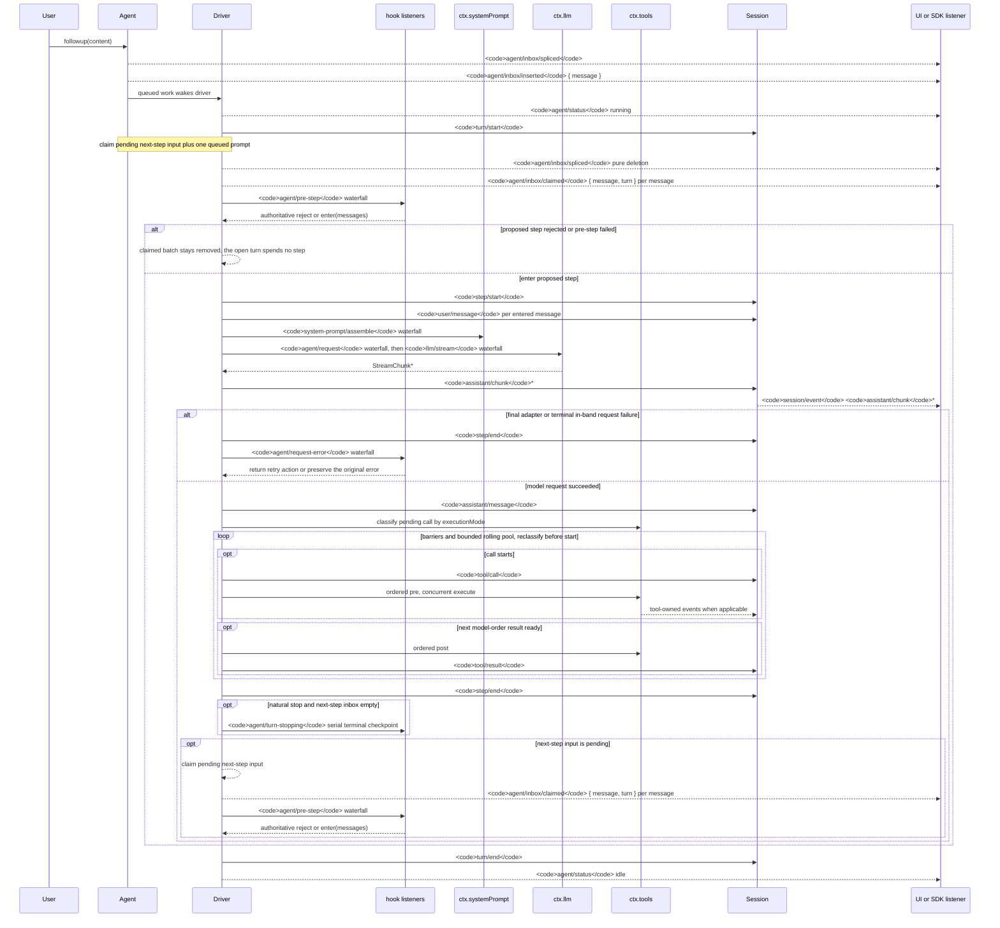

<!-- Generated by scripts/gen-doc-graphs.ts - do not edit by hand.
     Run `pnpm run gen-doc-graphs` to regenerate. -->

# Agent Turn And Step Lifecycle

This sequence is the visual companion to [architecture.md](architecture.md#turn-flow). It keeps durable replay facts on `session/event` and live control/status on `agent/*`.



The `assistant/message` event records every successful provider call, including content-less and `max-tokens` finishes. Empty content stays out of derived history, while the durable event keeps usage and `sourceEventSeqs` listing the exact `assistant/chunk` events, including an explicit empty list.

`dsh-compaction-basic` uses `agent/pre-step` for pressure before request derivation and `agent/request-error` only for canonical context overflow. Once either trigger qualifies, optional tool-result pruning runs before summary selection. Recovery works between the closed failed step and failed turn close, and opens a fresh retry turn only when pruning or summarization advances the surface replacement generation; otherwise the original request error remains authoritative.

The returned `agent/pre-step` decision is authoritative; listeners wrapping `next()` preserve downstream messages and `startsRequestSeries` unless replacement is intentional. Steering and injected context pass through the same waterfall after a later claim operation takes their next-step batch.

SDK users that need replayable transcript data should consume `session/event`; `agent/*` is the live coordination API for queue/status, prompt interception, request construction, steering, continuation, and errors.

<a id="reading-the-sequence"></a>

## Reading the sequence

The diagram is what happens in **one turn** after the user says one sentence. Time flows down. Each column is an actor speaking to another. Identify the nine columns first, then walk the stages.

A **step** is one model request plus the tools it invoked. A **turn** contains zero or more steps: it opens before the first claim and closes when nothing further is owed. The driver is [`ReactLoopAgent`](../packages/core/agent-loop/src/agent.ts) in `dsh-agent-loop`. The call chain is `followup` / `steer` / `inject` → `wakeDriver` → `kick` → `turn` → `preStep` → `step`.

| Arrow | Meaning |
|---|---|
| Solid into **Session** | A durable log event. It survives reload and is what `deriveMessages()`, fork, resume, and transcript rebuild from. |
| Dashed to **SDK** | A live `agent/*` notification. It exists only in this process. |
| Into **Hooks** / **Prompt** / **LLM** / **Tools** | A live extension point: emit, waterfall, or serial. Plugins intercept work here. |

The sentence at the top of this page is the reading rule: consume `session/event` to replay or draw UI; listen to `agent/*` to intercept a turn that is still running.

| Participant | Who it is |
|---|---|
| **User** | The human, ACP, or headless entry — anything that calls `agent.followup()` |
| **Agent** | The `ctx.agents` handle: inbox plus `followup` / `steer` / `inject` |
| **Driver** | `ReactLoopAgent` in `agent-loop`: `kick()` → `turn()` → `step()` |
| **Hooks** | Every plugin listening to `agent/pre-step`, `agent/request-error`, and `agent/turn-stopping` (compaction, plan mode, skills, Claude Code and Codex hook bridges) |
| **Prompt** | `ctx.systemPrompt` |
| **LLM** | `ctx.llm`; the provider adapter (for example DeepSeek) sits behind this service |
| **Tools** | `ctx.tools` |
| **Session** | The append-only session log. An arrow into it writes replayable history. |
| **SDK** | Web UI or SDK. They listen to live `agent/*` and durable `session/event`. |

## Stage 0: the message enters the inbox and wakes the driver

```text
User->>Agent: followup(content)
Agent-->>SDK: agent/inbox/spliced
Agent-->>SDK: agent/inbox/inserted { message }
Agent->>Driver: queued work wakes driver
Driver-->>SDK: agent/status running
```

`followup` does not call the model. It places a `UserMessage` on the **next-turn** queue and wakes the driver:

```text
send(message: UserMessage, target: InboxTarget, wakeup: boolean): void {
  const wakingAfterAbort = wakeup && this.phase.kind !== 'idle' && this.phase.abort.signal.aborted
  const resolvedTarget = wakingAfterAbort ? 'next-turn' : target
  this.inbox.splice(resolvedTarget, Infinity, 0, [message])
  if (wakeup) this.wakeDriver(wakingAfterAbort)
}

followup(input: UserMessage): void {
  this.send(input, 'next-turn', true)
}

steer(input: UserMessage): void {
  this.send(input, 'next-step', true)
}

inject(input: UserMessage): void {
  this.send(input, 'next-step', false)
}
```

[`send`](../packages/core/agent-loop/src/agent.ts) is the shared primitive. Two other entry points share the same inbox and do not appear as extra arrows on the diagram:

| Method | Queue | Wakes the driver |
|---|---|---|
| `followup` | `next-turn` | yes — opens a new turn |
| `steer` | `next-step` | yes — joins the current turn's next step |
| `inject` | `next-step` | no — waits until another message wakes the driver |

Each inbox mutation first records durable `agent/inbox/spliced`, then emits live `agent/inbox/inserted`. The SDK can draw a queued bubble immediately. Session does not yet contain `user/message`; that event is written only after `agent/pre-step` enters the step.

`wakeDriver` moves the phase from `idle` to `running`, emits `agent/status { status: 'running' }`, and enters `kick()` → `while (await this.turn())`. If the driver is already in maintenance, or the wake arrived after abort, the wake is latched and replayed when that activity converges.

## Stage 1: open the turn and claim from the inbox

```text
Driver->>Session: turn/start
Note: claim pending next-step input plus one queued prompt
Driver-->>SDK: agent/inbox/spliced  (pure deletion)
Driver-->>SDK: agent/inbox/claimed { message, turn }
```

The driver appends durable `turn/start` **before** claiming. The turn number starts here. A later reject still leaves that event in the log, so a turn that spends no model call remains a recorded attempt: "this try happened."

Claim rules live in [`Inbox.claim`](../packages/core/agent/src/inbox.ts):

```text
claim(target: InboxTarget, turn: number): UserMessage[] {
  const claimed = this.mutate('next-step', 0, this.nextStep.length, [], false)
  if (target === 'next-turn') {
    claimed.push(...this.mutate('next-turn', 0, 1, [], false))
  }
  for (const message of claimed) this.notifications.claimed(message, turn)
  return claimed
}
```

On the first claim of a turn (`target === 'next-turn'`):

1. Drain **every** pending next-step message (context left by an earlier `inject`, `steer`, or tool result).
2. Then take **one** next-turn message (this `followup`).

Claim is a pure deletion: the messages leave the queue, so another `agent/inbox/spliced` fires, then one live `agent/inbox/claimed { message, turn }` per message. Deleted messages do not return. If `agent/pre-step` later rejects, the batch stays removed.

On a later step of the same turn the target is `next-step`, so step 2 above does not run: no new `followup` is taken.

## Stage 2: `agent/pre-step` — whether this step may reach the model

```text
Driver->>Hooks: agent/pre-step waterfall
Hooks-->>Driver: reject or enter(messages)
```

`agent/pre-step` is a waterfall: every listener must call `next()` or the chain short-circuits. The payload is the claimed batch plus `turn`, `step`, and the turn `AbortSignal`. The return is only two kinds:

- `{ kind: 'enter', messages }` — this batch (possibly rewritten) will enter the step
- `{ kind: 'reject' }` — this step does not run

Compaction, plan mode, skills, and hook bridges listen here. The default `next()` keeps the claimed messages and may append runtime context (workspace excerpts and similar). The returned decision is authoritative; a listener that wraps `next()` preserves downstream messages unless it replaces them.

The first **alt** on the diagram is that decision.

**Reject, or a first enter rewritten empty:**

```text
if (decision.kind === 'reject') {
  turnEnds = { kind: 'blocked' }
  return false
}
if (phase.step === 0 && decision.messages.length === 0) {
  turnEnds = { kind: 'completed' }
  return false
}
```

There is no `step/start` and no model call. `turn/start` is already in the log, and `finally` still appends `turn/end` (`blocked` or `completed`). The log records "a turn opened and ended with zero steps."

**Enter** continues into stage 3.

## Stage 3: start the step, persist user messages, call the model

```text
Driver->>Session: step/start
Driver->>Session: user/message
Driver->>Prompt: system-prompt/assemble
Driver->>LLM: agent/request, then llm/stream
LLM-->>Driver: StreamChunk*
Driver->>Session: assistant/chunk*
Session-->>SDK: session/event assistant/chunk*
```

On enter the driver appends `step/start`, then one durable `user/message` per entered message. Only now does Session contain the user text. Model history comes from `session.deriveMessages()`, which reads the log, not the inbox.

Two waterfalls then run:

1. **`agent/request`** — plugins may replace provider, model, `maxTokens`, and other call config. This waterfall cannot mutate messages; model-visible content must already be in the log.
2. **`llm/stream`** — the adapter stream; `llm-replay` can short-circuit here.

Each streamed piece appends `assistant/chunk`; Session broadcasts `session/event`. Streaming UI follows those durable chunks, not `agent/*`.

### Diagram vs source: `system-prompt/assemble`

The diagram places `system-prompt/assemble` after `user/message`, next to the LLM call. In [`preStep()`](../packages/core/agent-loop/src/agent.ts) assemble runs **before** the `agent/pre-step` waterfall, still before `step/start`:

```text
const claimed = this.inbox.claim(target, position.turn)
const assembly = await this.loopCtx.systemPrompt.assemble(assembleContextFor(this, signal))
signal.throwIfAborted()
const sections = renderContextSections(assembly)
const context = this.runtimeContext.project(joinContextSections(sections), sections)
const decision = await this.dispatch.waterfall(
  'agent/pre-step', { messages: claimed, ...position, signal },
  (): Promise<PreStepDecision> => Promise.resolve<PreStepDecision>({
    kind: 'enter',
    messages: context === undefined ? claimed : [...claimed, context],
  }),
)
```

[architecture.md](architecture.md#turn-flow) matches that source order: claim → assemble → `agent/pre-step` → `step/start`. Read `agent.ts` in source order. The diagram groups prompt assembly with the model call so the "what the model is asked" column sits next to the LLM.

## Stage 4: model request failure vs success

The nested **alt** is the provider outcome.

**Failure branch** (adapter failure, in-band stream error):

```text
step/end
agent/request-error waterfall
retry or preserve the original error
```

`dsh-llm-retry` and canonical overflow repair in `dsh-compaction-basic` listen on `agent/request-error`. A listener returns `{ kind: 'retry' }` without calling `next()` when it owns recovery, or calls `next()` to delegate. The default is terminal failure.

### Diagram vs source: `agent/request-error`

The diagram draws `step/end` before `agent/request-error`. In [`step()`](../packages/core/agent-loop/src/agent.ts) an in-band `finish.kind === 'error' | 'aborted'` runs the waterfall **inside** the same `step()` `while (true)`:

```text
if (finish.kind === 'error' || finish.kind === 'aborted') {
  const action = await this.dispatch.waterfall(
    'agent/request-error', {
      turn, step, provider: request.provider,
      failure: finish.failure, retryPolicy: preparedCall?.retryPolicy, signal,
    },
    () => Promise.resolve<RequestErrorAction>(undefined),
  )
  if (action?.kind !== 'retry') {
    throw new LlmError(finish.failure.message, finish.failure.code, finish.failure)
  }
  continue
}
```

Two recovery paths:

- **In-step retry.** `{ kind: 'retry' }` hits `continue`. No `step/end` between attempts. The step number stays the same.
- **Throw.** Any other result throws. `turn()` appends `step/end` in `finally`, then ends the turn with `error`. Compaction recovery that needs a fresh turn sits after that failed step closes and before the failed turn closes; a new retry turn opens only when pruning or summarization advances the surface replacement generation.

**Success branch:**

```text
assistant/message
classify pending call by executionMode
```

The driver appends `assistant/message` for every successful provider call, including empty content and `max-tokens`. Empty content stays out of `deriveMessages()`; the event still keeps usage and `sourceEventSeqs` listing the `assistant/chunk` events, including an explicit empty list. A mid-stream cancel finalizes the delivered prefix as `assistant/message` with `interrupted: true`.

Then the assistant message is classified:

- no `tool-call` blocks → the step completes (`completed`, or `max-tokens` if that was the finish)
- one or more `tool-call` blocks → stage 5

## Stage 5: the tool loop inside the same step

```text
loop barriers and bounded rolling pool
  opt call starts
    tool/call
    ordered pre, concurrent execute
  opt next model-order result ready
    ordered post
    tool/result
```

This is not a new step. It is the scheduler for **this step's** tool-call blocks.

[`executeToolCalls`](../packages/core/agent-loop/src/tool-calls.ts) policy:

- **Exclusive** calls (the default) form a barrier: later calls do not start until earlier exclusive work finishes.
- **Concurrency-safe** calls (`isConcurrencySafe === true`) use a bounded rolling pool and are reclassified before each start.
- **Model order still governs policy and results:** `tools/pre-execute`, result commit, and `tool/result` stay in model order; bodies may overlap.

This is the same pipeline as a manual `ctx.tools.execute(...)`, except the loop is the caller:

durable `tool/call` → `tools/pre-execute` → `guard()` → `tools/execute` → the tool body → `tools/post-execute` → live `tools/result` → durable `tool/result`

The [tool pipeline](tool-execution-pipeline.md#reading-the-pipeline) owns that per-call sequence. [Reading `tool-calls.ts`](tool-execution-pipeline.md#reading-tool-calls) owns grouping, the rolling pool, and model-order commit. `Tools-->>Session: tool-owned events` are extra log events a tool itself appends (`todo/write`, `fs/observed`, and similar).

`tools/result` is the registry's live observation event. `tool/result` is the session log event the loop appends afterward. Result context (`deferContext`, `additionalContexts`) splices into the **next-step** inbox and is claimed at the next step boundary, not as another model call inside this `step()`.

`step()` then returns:

- `{ kind: 'completed' }` when nothing further is owed to the model (no tool-call, or a tool `concluded` the turn)
- `null` when tools still owe a request (the usual case after tools run: their results must go back to the model)

A `null` return does **not** continue the inner `while` used for `agent/request-error` retry. The outer `turn()` loop appends `step/end` and opens the **next step**.

## Stage 6: close the step and decide whether to take another

```text
Driver->>Session: step/end
opt natural stop and next-step inbox empty
  agent/turn-stopping
opt next-step input is pending
  claim next-step
  agent/inbox/claimed
  agent/pre-step again
```

Every entered step appends `step/end` in a `finally`. Then:

```text
if (turnEnds && this.inbox.nextStep.length === 0) {
  await this.dispatch.serial('agent/turn-stopping', { turn, signal })
  signal.throwIfAborted()
}
if (turnEnds && this.inbox.nextStep.length === 0) break
target = 'next-step'
```

Two cases:

1. **Natural stop and next-step empty.** The driver runs serial `agent/turn-stopping` (no `next()`; listener order cannot change the outcome; a listener that objects calls `agent.steer(...)` and the machine re-reads the inbox) and `break`s out of the step loop. Claude Code and Codex Stop hooks listen here.
2. **Work remains.** Tools still owe a request, or `steer` / `inject` / tool context remains in next-step. The next `claim` uses target `next-step` (no next-turn message) and runs `agent/pre-step` again. That is the trailing **opt** at the bottom of the diagram.

One turn may contain step 1 (user text, model, tools) then step 2 (tool results, another model request) until no work remains.

## Stage 7: close the turn and idle the driver

```text
Driver->>Session: turn/end
Driver-->>SDK: agent/status idle
```

`turn/end` always pairs with `turn/start` in `finally`, with a reason such as `completed`, `blocked`, `max-tokens`, `aborted`, or `error`. If next-turn still has queued `followup` messages, `turn()` returns true, `kick()` opens another turn immediately, and the SDK may see only a brief `idle`, or none. An empty inbox yields `agent/status { status: 'idle' }`.

To read the source against the diagram, open [`packages/core/agent-loop/src/agent.ts`](../packages/core/agent-loop/src/agent.ts) and follow `followup` → `wakeDriver` → `kick` → `turn` → `preStep` → `step`. Every `append`, `waterfall`, and `serial` on that path is one arrow on the diagram. [Reading `agent.ts` against the lifecycle](#reading-agent-ts) walks that file top to bottom.

## Control-flow summary

```text
followup → inbox(next-turn) → wake
  turn/start
    claim(all next-step + one next-turn)
    assemble + agent/pre-step
      reject / empty → no step, still turn/end
      enter →
        step/start, user/message
        agent/request → llm/stream → assistant/chunk* → assistant/message
        on failure → step/end → agent/request-error (may retry)
        on tool-call → schedule tools → tool/call / tool/result
        step/end
        model still owed or next-step nonempty → claim → pre-step (next step, same turn)
        else → turn-stopping
  turn/end
  status idle (or the next turn immediately)
```

The `on failure → step/end → agent/request-error` line follows the diagram. Source order for in-step retry is `agent/request-error` then `continue` with no `step/end`; `step/end` runs when `step()` returns or throws.

## Two concrete traces

A user message with no tool calls:

```text
followup
  agent/inbox/spliced, agent/inbox/inserted
  agent/status running
  turn/start
  claim → agent/inbox/spliced, agent/inbox/claimed
  assemble, agent/pre-step enter
  step/start, user/message
  agent/request, llm/stream, assistant/chunk*, assistant/message
  step/end
  agent/turn-stopping
  turn/end
  agent/status idle
```

The same turn after the model requests one tool:

```text
... assistant/message with a tool-call block
  tool/call
  tools/pre-execute → guard → tools/execute → body → tools/post-execute
  tools/result (live), tool/result (durable)
  step/end                         // step 1
  claim next-step, agent/pre-step
  step/start, user/message         // tool context, not a new followup
  agent/request, llm/stream, assistant/chunk*, assistant/message
  step/end                         // step 2, same turn
  agent/turn-stopping
  turn/end
```

<a id="durable-vs-live"></a>

## Durable vs live names

A name is durable when `Session.append` writes it into `SessionEventMap`; it stays in the session log and survives reload (for example under `.sessions`). A name is a live extension point when Cordis emits or waterfalls it in-process; it is gone after the process exits.

`session/event` is the live bus that broadcasts each just-appended durable event. It is not itself a log type. Reloading a session rebuilds history from the log; it does not replay `agent/pre-step` or `tools/result`.

### Durable session events

These are the sequence's solid arrows into Session. After reload they are still in the log:

| Name | What it records |
|---|---|
| `turn/start` / `turn/end` | Open and close of one turn. A reject still leaves `turn/start`; a turn with no model call is still a recorded attempt. |
| `step/start` / `step/end` | Open and close of one step: one model request plus the tools it invoked. |
| `user/message` | A user-role message that entered the step and that the model will see. |
| `assistant/chunk` | One streamed piece, for replay and UI fidelity. |
| `assistant/message` | The assembled assistant message. Derived history reads this, not the chunks. |
| `tool/call` | One model-requested tool invocation, with the raw arguments string. |
| `tool/result` | The model-facing tool outcome. |
| `agent/inbox/spliced` | One normalized inbox mutation (insert, claim, cancel). The `agent/` prefix is durable here. |

Tool-owned log events such as `todo/write` and `fs/observed` are the same class. [architecture.md](architecture.md#events) owns the taxonomy (`turn/*`, `step/*`, `user/message`, `assistant/*`, `tool/*`, plus merged members such as `agent/inbox/spliced`). The [persistence catalog](persistence-catalog.md) lists every `SessionEventMap` member.

### Live extension points

These exist only in the process. They fall in three domains: agent coordination, capability / assembly, and the `session/event` bus.

Agent (queue, intercept, coordinate):

| Name | Role |
|---|---|
| `agent/inbox/inserted` | One message entered the live inbox. The SDK can draw a queued bubble. |
| `agent/inbox/claimed` | One message left the inbox inside its open turn. |
| `agent/status` | `idle` ⇄ `running` |
| `agent/pre-step` | Waterfall: rewrite or reject the claimed batch. |
| `agent/request` | Waterfall: replace call config. |
| `agent/request-error` | Waterfall: retry or preserve a failed request. |
| `agent/turn-stopping` | Serial: the turn is about to close (no `next()`). |

Capability and assembly:

| Name | Role |
|---|---|
| `system-prompt/assemble` | Waterfall: prompt sections and tool schemas. |
| `llm/stream` | Waterfall: the adapter stream. |
| `tools/pre-execute` | Waterfall: policy before the tool body. |
| `tools/execute` | Waterfall: around the tool body. |
| `tools/post-execute` | Waterfall: accept, block, or replace the result. |
| `tools/result` | Live registry observation, not `tool/result`. |
| `session/event` | Broadcast of a just-appended durable event. |

`followup` / `steer` / `inject`, `claim`, and `wakeDriver` are methods, not events. Their effects become the names above.

### Two pairs that look alike

`tool/result` is durable; `tools/result` is live. The pipeline emits live `tools/result` first; the loop then appends durable `tool/result`.

`agent/inbox/spliced` is durable; `agent/inbox/inserted` and `agent/inbox/claimed` are live. Each inbox mutation writes spliced first, then inserted or claimed. After the process is gone, only spliced can rebuild the queue.

<a id="reading-agent-ts"></a>

## Reading `agent.ts` against the lifecycle

[`ReactLoopAgent`](../packages/core/agent-loop/src/agent.ts) **is** the diagram's Driver. This section walks that file top to bottom against the stages above. The mermaid walk and the durable-versus-live name list stay in [Reading the sequence](#reading-the-sequence) and [Durable vs live names](#durable-vs-live); the facts here are the same control flow, ordered as the source is written.

The call chain is:

`followup` / `steer` / `inject` → `send` → `wakeDriver` → `kick` → `turn` → `preStep` → `step` → `buildRequest` / `executeToolCalls`

The file nests three loops:

| Loop | Code | What it is in the lifecycle |
|---|---|---|
| Outer | `kick()`: `while (await this.turn())` | One driver. Extra queued `followup` messages open another turn immediately. `finally` returns the phase to idle and may re-wake. |
| Middle | `turn()`: inner `while (true)` | Steps of the **same** turn. First iteration uses `target = 'next-turn'`; later iterations set `target = 'next-step'`. |
| Inner | `step()`: `while (true)` | **Only** `{ kind: 'retry' }` from `agent/request-error`. Not a new step. A `null` return after tools is **not** this loop. |

| Code | Lifecycle stage |
|---|---|
| `followup` → `send(..., 'next-turn', true)` | Stage 0: enqueue and wake. `inbox.splice` writes durable `agent/inbox/spliced`, then live `inserted`. |
| `steer` → next-step and wakeup; `inject` → next-step, **no** wakeup | Same inbox. The mermaid does not draw extra arrows for these two. |
| `wakeDriver` + `setPhase` | `agent/status running` on idle→running, then `kick()`. If the phase is not idle (maintenance, or a wake after abort), the driver may latch `wakeRequested`. |
| `kick`: `while (await this.turn())` | One driver; extra queued followups open another turn immediately. `finally` → idle, maybe re-wake. |
| `turn`: `append('turn/start')` then inner `while` | Stage 1 opens the turn. First loop `target = 'next-turn'`; later `target = 'next-step'`. `finally` always writes `turn/end`. After a natural stop, returns true if the inbox still has pending work; reject / empty first enter return false without that check. |
| `preStep`: `inbox.claim` → `systemPrompt.assemble` → `agent/pre-step` waterfall | Stages 1–2. **Source order is not mermaid order:** assemble runs **before** pre-step and **before** `step/start`. Claim: all next-step, plus one next-turn iff target is next-turn. Reject or empty first enter → no `step/start` (`blocked` / `completed`), still `turn/end`. |
| `turn` after enter: `step/start`, `user/message` per entered message, `step()` | Stage 3 persists user messages. History is `session.deriveMessages()`, not the inbox. |
| `buildRequest`: `agent/request` waterfall then `llm.prepareCall` | Stage 3 request config. Logs `request/header` / `request/context` when needed. |
| `step` inner `while`: `llm.stream` → `assistant/chunk*` | Stage 3 streaming. UI follows durable chunks via `session/event`. |
| `finish.kind === 'error'\|'aborted'` → `agent/request-error`; `{kind:'retry'}` → `continue` | Stage 4. **Source is not mermaid order:** in-step retry does **not** write `step/end` between attempts. Throw → `turn`'s `finally` writes `step/end`, the turn ends `error`. Compaction's fresh retry turn is a different path. |
| Success: `assistant/message`; no tool-call → `completed`; `max-tokens` sticky | Stage 4 success. |
| `executeToolCalls(...)` + splice contexts into next-step | Stage 5. Scheduler in [`tool-calls.ts`](../packages/core/agent-loop/src/tool-calls.ts) ([Reading `tool-calls.ts`](tool-execution-pipeline.md#reading-tool-calls)). The pipeline itself is `dsh-tools` ([tool pipeline](tool-execution-pipeline.md#reading-the-pipeline)). A `null` return still owes a model request → **next step of the same turn**, not the inner retry `while`. |
| `step/end` in `turn`'s inner `finally`; `agent/turn-stopping` serial if `turnEnds && nextStep empty`; else `target='next-step'` | Stages 6–7. |

Live claimed/inserted notifications are the constructor callbacks on `Inbox` (not methods of `ReactLoopAgent` itself). Claim implementation is [`inbox.ts`](../packages/core/agent/src/inbox.ts) (`claim` / `splice`).

### Stage 0: enqueue and wake (`send`, `wakeDriver`, `kick`)

```text
    this.inbox = new Inbox(session, {
      inserted: (message) => { this.dispatch.emit('agent/inbox/inserted', { message }) },
      discarded: (message) => { this.dispatch.emit('agent/inbox/discarded', { message }) },
      claimed: (message, turn) => { this.dispatch.emit('agent/inbox/claimed', { message, turn }) },
    })
```

`splice` writes durable `agent/inbox/spliced` **before** the live projection mutates, then the callbacks emit live `inserted` (or `discarded` when the splice removes messages with `discardRemoved === true`). Claim uses `discardRemoved === false`, so a claim is a pure deletion plus live `claimed`, not `discarded`. `discarded` is not an arrow on the mermaid.

```text
  private setPhase(next: Phase): void {
    const previousStatus = this.status
    this.phase = next
    const status = this.status
    if (status !== previousStatus) {
      this.dispatch.emit('agent/status', { status })
    }
  }
```

`status` is `'idle'` when the phase is `idle` **or** `maintenance`, and `'running'` only for `kind: 'running'`. `agent/status` therefore fires on idle↔running, not on every phase field change.

This is the diagram's stage 0: `User->>Agent: followup` → `agent/inbox/spliced` + `inserted` → `queued work wakes driver` → `agent/status running`.

```text
  send(message: UserMessage, target: InboxTarget, wakeup: boolean): void {
    // Waking input cannot join an aborted activity, so it starts the next turn.
    // Captured before the insertion so a reentrant cancel from a splice observer cannot reclassify it.
    const wakingAfterAbort = wakeup && this.phase.kind !== 'idle' && this.phase.abort.signal.aborted
    const resolvedTarget = wakingAfterAbort ? 'next-turn' : target
    this.inbox.splice(resolvedTarget, Infinity, 0, [message])
    if (wakeup) this.wakeDriver(wakingAfterAbort)
  }

  followup(input: UserMessage): void {
    this.send(input, 'next-turn', true)
  }

  steer(input: UserMessage): void {
    this.send(input, 'next-step', true)
  }

  inject(input: UserMessage): void {
    this.send(input, 'next-step', false)
  }
```

`followup` does not call the model. The three entries differ only in queue and whether they wake:

| Method | Queue | Wakes the driver |
|---|---|---|
| `followup` | `next-turn` | yes — opens a new turn |
| `steer` | `next-step` | yes — joins the current turn's next step |
| `inject` | `next-step` | no — waits until another message wakes the driver |

`wakingAfterAbort` is computed **before** `splice`, so a reentrant `cancel` from a splice observer cannot reclassify the target. A waking message that arrives against an aborted activity is forced onto `next-turn`; it cannot join the aborted work as `next-step`.

```text
  private wakeDriver(wakeAfterAbort = false): void {
    if (this.phase.kind !== 'idle') {
      // Maintenance and aborted drivers cannot deliver the wake: latch it for
      // replay at convergence. Live drivers claim queued work themselves;
      // disposal never latches, so teardown waits on no model turn.
      const reason = this.phase.abort.signal.reason as AgentCancelCause | undefined
      if (reason?.kind !== 'disposed' && (this.phase.kind === 'maintenance' || wakeAfterAbort)) {
        this.phase.wakeRequested = true
      }
      return
    }
    const driver = Promise.withResolvers<void>()
    this.activityDone = driver.promise
    this.setPhase({
      kind: 'running',
      abort: new AbortController(),
      turn: this.phase.lastTurn,
      step: 0,
      wakeRequested: false,
    })
    this.loopCtx.agents.withInitiator(this, () => this.kick()).then(driver.resolve, driver.reject)
  }
```

Three cases when `wakeDriver` runs and the phase is **not** idle:

- **Live `running`, not aborted.** The method returns without latching. The live driver claims the queue itself (`turn()` returning true, or the next-step claim inside the open turn).
- **Maintenance, or a wake after abort, and the cancel cause is not `disposed`.** Sets `wakeRequested = true`. Replay happens when that activity converges (`kick` `finally`, or `runMaintenance` `finally`).
- **`disposed`.** Never latches, so teardown does not wait on another model turn.

A wake sent while **idle** always opens a turn boundary (even if the message was later cleared). Only a latched replay is suppressed when `inbox.hasPending` is already false.

```text
  private async kick(): Promise<void> {
    try {
      while (await this.turn()) {}
    } catch (_error) {
      // Reported failures and cancellation are contained at the driver boundary.
    } finally {
      /* v8 ignore next -- kick owns a running phase until this driver boundary */
      if (this.phase.kind === 'running') {
        const { turn, wakeRequested } = this.phase
        this.setPhase({ kind: 'idle', lastTurn: turn })
        if (wakeRequested && this.inbox.hasPending) this.wakeDriver()
      }
    }
  }
```

`kick` is the outer loop: keep calling `turn()` until it returns false (inbox empty, or the turn ended without handing the driver another turn). Thrown failures are contained here; `throwError` already emitted live `agent/error` at the failure site. `finally` publishes `agent/status idle` when the phase is still `running`, then replays a latched wake if the inbox still holds work.

### Stages 1–2: open the turn, claim, `agent/pre-step` (`turn`, `preStep`)

`turn()` appends `turn/start` **before** the step loop. The turn number increments here. A later reject still leaves that event in the log.

```text
    const turn = phase.turn + 1
    try {
      this.session.append('turn/start', { turn })
    } catch (error: unknown) {
      this.throwError(error)
    }
    phase.turn = turn
    let turnEnds: TurnEndReason | null = null
    let target: InboxTarget = 'next-turn'
    try {
      while (true) {
        signal.throwIfAborted()
        const step = phase.step + 1
        const decision = await this.preStep(target, { turn, step })
        if (decision.kind === 'reject') {
          turnEnds = { kind: 'blocked' }
          return false
        }
        if (turnEnds && decision.messages.length === 0) break
        // A removed waking message or an enter decision rewritten to empty
        // still owns the initial turn boundary, but it spends no model call.
        if (phase.step === 0 && decision.messages.length === 0) {
          turnEnds = { kind: 'completed' }
          return false
        }
```

First iteration: `target === 'next-turn'`. Later iterations (after a step that did not stop the turn) set `target = 'next-step'`. That is the trailing **opt** on the mermaid.

Claim and assemble both run inside `preStep()`, not inside `step()`:

```text
    const claimed = this.inbox.claim(target, position.turn)
    const assembly = await this.loopCtx.systemPrompt.assemble(assembleContextFor(this, signal))
    signal.throwIfAborted()
    const sections = renderContextSections(assembly)
    const context = this.runtimeContext.project(joinContextSections(sections), sections)
    const decision = await this.dispatch.waterfall(
      'agent/pre-step', { messages: claimed, ...position, signal },
      (): Promise<PreStepDecision> => Promise.resolve<PreStepDecision>({
        kind: 'enter',
        messages: context === undefined ? claimed : [...claimed, context],
      }),
    )
    signal.throwIfAborted()
    return decision.kind === 'reject' ? decision : { ...decision, assembly }
```

Mermaid mapping for this block: `turn/start` → claim → `agent/inbox/claimed` → `agent/pre-step` → reject or enter.

`Inbox.claim` drains **every** pending next-step message, then takes **one** next-turn message only when `target === 'next-turn'`. Claim is a pure deletion: another durable `agent/inbox/spliced`, then one live `agent/inbox/claimed { message, turn }` per message. Deleted messages do not return to the inbox if `agent/pre-step` later rejects.

Default `next()` keeps the claimed messages and may append projected runtime context. The returned decision is authoritative.

**Reject:** `turnEnds = { kind: 'blocked' }`, `return false`. No `step/start`. `finally` still appends `turn/end`.

**Empty first enter** (`phase.step === 0` and `messages.length === 0`): `turnEnds = { kind: 'completed' }`, `return false`. Same: recorded turn, zero steps, no model call.

**Empty later enter while `turnEnds` is already set:** `break` out of the step loop without opening another step. That path is not an extra mermaid arrow; it is how a completed step that still iterated, then found an empty rewritten batch, stops.

This is the first diagram-versus-source mismatch already documented in stage 3: the mermaid draws `system-prompt/assemble` after `user/message`; source order is claim → assemble → `agent/pre-step` → then `step/start`. [architecture.md](architecture.md#turn-flow) matches the source.

### Stage 3: enter the step, persist user messages, call the model

Enter continues in `turn()`:

```text
        signal.throwIfAborted()
        this.session.append('step/start', { turn, step })
        phase.step = step
        try {
          for (const message of decision.messages) {
            this.session.append('user/message', message, { surfaceOp: 'append' })
          }
          // max-tokens is sticky: once any step hits the ceiling, later steps
          // that complete normally must not downgrade the turn outcome.
          const stepEnd = await this.step(decision.assembly)
          // max-tokens stays sticky: a later completed step must not
          // downgrade the turn outcome.
          if (turnEnds === null || turnEnds.kind !== 'max-tokens') turnEnds = stepEnd
        } finally {
          this.session.append('step/end', { turn, step })
        }
```

Only after enter does Session contain the user text. `phase.step` advances here, so a reject or empty first enter never spends a step number.

`step()` then:

| Code | Arrow on the diagram |
|---|---|
| `buildRequest()` → `agent/request` waterfall | `Driver->>LLM: agent/request` |
| `llm.prepareCall` / `preparedCall?.stream(request) ?? this.loopCtx.llm.stream(request)` | `llm/stream` |
| `append('assistant/chunk')` per streamed piece | `assistant/chunk*` + `session/event` |

Model history is `this.session.deriveMessages()`, which reads the log, not the inbox.

```text
    while (true) {
      const { request, preparedCall } = await this.buildRequest(
        turn, step, assembly.tools, system, this.session.deriveMessages(), signal,
      )
      const assembler = new BlockAssembler()
      const chunkSeqs: number[] = []
      try {
        const stream = preparedCall?.stream(request) ?? this.loopCtx.llm.stream(request)
        signal.throwIfAborted()
        for await (const chunk of stream) {
          signal.throwIfAborted()
          chunkSeqs.push(this.session.append('assistant/chunk', { turn, step, chunk }).seq)
          assembler.push(chunk)
        }
        signal.throwIfAborted()
      } catch (error: unknown) {
        if (signal.aborted) {
          const content = assembler.interruptedBlocks()
          if (content.length > 0) {
            this.session.append('assistant/message', {
              turn,
              step,
              message: createAssistantMessage({
                content,
                source: { provider: request.provider, model: request.model },
              }),
              interrupted: true,
              ...assembler.usage === undefined ? {} : { usage: assembler.usage },
            }, { surfaceOp: 'append', sourceEventSeqs: chunkSeqs })
          }
        }
        throw error
      }
```

A mid-stream cancel finalizes the delivered prefix as `assistant/message` with `interrupted: true` when that prefix is non-empty, then rethrows. `kick` contains the throw; `turn`'s `catch` records `turnEnds = { kind: 'aborted', reason }` when the signal is aborted.

`buildRequest` is the request-config half of stage 3:

```text
    const proposedConfig = await this.dispatch.waterfall(
      'agent/request', { turn, step, signal },
      () => Promise.resolve(seedConfig),
    )
```

The waterfall cannot rewrite messages. Missing `provider`/`model` after it throws. `llm.prepareCall` binds adapter defaults; `NO_ADAPTER` is the only `LlmError` this method swallows, leaving `config = proposedConfig` for a middleware-served unregistered route.

It then appends durable `request/header` on the instance's first call (`initial` or `resume`) and on a later header change, and durable `request/context` when `provider`, `model`, or `contextWindow` differs from the previous context. Those two event names are not arrows on the mermaid; they are how the frozen request is anchored in the log. The frozen request carries `messages: boundaryMessages` (`deriveMessages()`), optional `system` / `tools`, `sessionId`, and `signal`.

### Stage 4: failure versus success (inner `step()` loop)

In-band `finish.kind === 'error' | 'aborted'` runs `agent/request-error` **inside** the same `step()` `while (true)`:

```text
      const finish = assembler.finish
      if (finish.kind === 'error' || finish.kind === 'aborted') {
        const action = await this.dispatch.waterfall(
          'agent/request-error', {
            turn,
            step,
            provider: request.provider,
            failure: finish.failure,
            retryPolicy: preparedCall?.retryPolicy,
            signal,
          },
          () => Promise.resolve<RequestErrorAction>(undefined),
        )
        signal.throwIfAborted()
        if (action?.kind !== 'retry') {
          throw new LlmError(finish.failure.message, finish.failure.code, finish.failure)
        }
        continue
      }
```

This is the second diagram-versus-source mismatch: the mermaid draws `step/end` before `agent/request-error`. Source:

- `{ kind: 'retry' }` → `continue`. **No** `step/end` between attempts. The step number stays the same.
- Any other result → `throw`. `turn()`'s inner `finally` writes `step/end`, then the turn `catch` sets `turnEnds` to `error` (or `aborted` if the signal aborted) and `throwError` emits `agent/error`. Compaction recovery that needs a fresh turn sits after that failed step closes and before the failed turn closes; that path is not this inner `while`.

Success appends `assistant/message` for every successful provider call, including empty content. Empty content stays out of `deriveMessages()`; the event still keeps usage and `sourceEventSeqs`. `finish.kind === 'max-tokens'` returns `{ kind: 'max-tokens' }` **before** inspecting tool-call blocks, so a max-tokens finish never enters `executeToolCalls`. `turn()` keeps `max-tokens` sticky: a later `{ kind: 'completed' }` must not downgrade `turnEnds`.

```text
      const message = createAssistantMessage({
        content: assembler.blocks(),
        source: {
          provider: request.provider,
          model: request.model,
          ...assembler.replayState !== undefined ? { replayState: assembler.replayState } : {},
        },
      })
      this.session.append(
        'assistant/message',
        {
          turn,
          step,
          message,
          ...assembler.usage === undefined ? {} : { usage: assembler.usage },
        },
        { surfaceOp: 'append', sourceEventSeqs: chunkSeqs },
      )
      if (finish.kind === 'max-tokens') return { kind: 'max-tokens' }

      const toolCalls = message.content.filter(block => block.type === 'tool-call')
      if (toolCalls.length === 0) return { kind: 'completed' }
      const { concluded } = await executeToolCalls(
        this.loopCtx, turn, step, toolCalls, signal,
        context => this.inbox.splice('next-step', this.inbox.nextStep.length, 0, [context]),
      )
      return concluded ? { kind: 'completed' } : null
```

No `tool-call` blocks → `{ kind: 'completed' }` (stage 4 success, skip stage 5). One or more `tool-call` blocks → stage 5.

### Stage 5: tools, still inside this step

The mermaid **loop** (barriers / rolling pool, `tool/call`, `tool/result`) lives in [`tool-calls.ts`](../packages/core/agent-loop/src/tool-calls.ts), not in `agent.ts`. The execution pipeline itself is `dsh-tools`; see [Reading the pipeline](tool-execution-pipeline.md#reading-the-pipeline). [Reading `tool-calls.ts`](tool-execution-pipeline.md#reading-tool-calls) walks that file.

The `acceptContext` callback splices each committed result context onto the **end** of next-step (`start = this.inbox.nextStep.length`, `deleteCount = 0`). Those contexts are claimed at the **next** step boundary, not as another model call inside this `step()`.

`executeToolCalls` returns `{ concluded }`. `concluded` is true when any committed result carried `concludesTurn`. `step()` then returns:

- `{ kind: 'completed' }` — nothing further is owed to the model (no tool-call, or a tool concluded the turn)
- `null` — tools still owe a request (the usual case after tools run: results must go back to the model)

A `null` return does **not** continue the inner `while` used for `agent/request-error` retry. The outer `turn()` loop hits `finally` (`step/end`) and, because `turnEnds` is `null` (unless a prior step already stuck `max-tokens`), does not run `agent/turn-stopping` and does not `break`. It sets `target = 'next-step'` and opens the **next step of the same turn**.

### Stages 6–7: close the step, maybe another step, close the turn

After `step()` returns, `turn()` still holds the inner `finally` that always appends `step/end` for an entered step, then:

```text
        signal.throwIfAborted()
        if (turnEnds && this.inbox.nextStep.length === 0) {
          await this.dispatch.serial('agent/turn-stopping', { turn, signal })
          signal.throwIfAborted()
        }
        if (turnEnds && this.inbox.nextStep.length === 0) break
        target = 'next-step'
      }
    } catch (error: unknown) {
      if (signal.aborted) {
        turnEnds = { kind: 'aborted', reason: signal.reason as AgentCancelCause }
        throw error
      }
      // Every failure is structured: an `LlmError` keeps its facts, anything
      // else flattens to `errorChain` text under the `UNKNOWN` code.
      turnEnds = {
        kind: 'error',
        error: error instanceof LlmError
          ? error.failure
          : { message: errorChain(error), code: 'UNKNOWN' },
      }
      this.throwError(error)
    } finally {
      try {
        // oxlint-disable-next-line typescript/no-non-null-assertion -- every exit assigns a turn ending
        this.session.append('turn/end', { turn, reason: turnEnds! })
      } catch (error: unknown) {
        this.throwError(error)
      }
    }
    if (!this.inbox.hasPending) return false
    phase.abort = new AbortController()
    // A fresh controller makes a latch set on the old one stale: the live driver claims the queue itself.
    phase.wakeRequested = false
    phase.step = 0
    return true
```

| Code | Diagram |
|---|---|
| inner `finally` `step/end` | every entered step closes |
| `agent/turn-stopping` serial | **opt** natural stop; no `next()` |
| `target = 'next-step'` then `preStep` | trailing **opt** claim |
| `turn/end` always in the outer `finally` | pairs with `turn/start` |
| `turn()` returns `true` | after a natural stop, next-turn still pending; `kick()` opens another turn immediately |
| `kick()` `finally` `setPhase(idle)` | `agent/status idle` |

`agent/turn-stopping` runs only when `turnEnds` is already set **and** next-step is empty. Listeners that object call `agent.steer(...)`; the machine re-reads the inbox on the second `if` (if next-step is then non-empty, it does not `break`). Claude Code and Codex Stop hooks listen here.

The `catch` distinguishes abort from structured failure before `finally` writes `turn/end`. `return false` on reject / empty first enter still runs that `finally`.

When `turn()` returns `true`, it replaces the abort controller, clears a stale latch, resets `step` to 0, and leaves `phase.turn` at the turn just closed so the next `turn()` increments again. The driver stays `running`; the SDK may see no `idle` between those turns.

### Methods the sequence does not draw

These are in the same file and affect the driver, but they are not mermaid arrows:

| Method | Role |
|---|---|
| `cancel(cause, options)` | Unless `keepInbox`, `inbox.clear()` (durable splices that empty next-step then next-turn) and `wakeRequested = false`. If not idle, `abort.abort(cause)`. |
| `runMaintenance(job)` | Legal only while idle. Sets `kind: 'maintenance'` (status still reports `idle`). `finally` returns to idle and may `wakeDriver()` if `wakeRequested && hasPending`. |
| `whenIdle()` | Waits until `activityDone` is stable (no newer driver or maintenance replaced it during the await). |
| `throwError(error)` | Emits live `agent/error { turn, step, error }`, then throws. `kick`'s `catch` contains the throw. |
| `status` getter | `'idle'` for `idle` and `maintenance`; `'running'` only for the running phase. |

`requestProposal` strips adapter-owned `reasoningEffort` / `maxTokens` flags before plugins see the seed config in `agent/request`. It is not a lifecycle stage.

### File order

1. Constructor: fused `dispatch`, `Inbox` live callbacks, `lastTurn` from the last `turn/start` in the log, initial `idle` phase, agent-scoped `scope` / `ctx`.
2. `followup` (calls `send`) → `send` → `wakeDriver`.
3. `kick` → `turn`.
4. `preStep`: claim + assemble + `agent/pre-step`.
5. `turn` after enter: `step/start` / `user/message` → `step`.
6. `buildRequest`: `agent/request`, `prepareCall`, optional `request/header` / `request/context`; then stream / chunk / `assistant/message`.
7. `executeToolCalls`; `null` returns to `turn()` for the next step.
8. `turn-stopping` → `turn/end` → if the inbox still has pending work, `turn()` returns true.

Read [Reading the sequence](#reading-the-sequence) for the mermaid-stage tables and the two concrete traces; this section is the same facts from the file's order.

Maintenance mode: curated Mermaid sequence and source-mapped walkthrough; exact event signatures live in the generated Cordis catalog.
