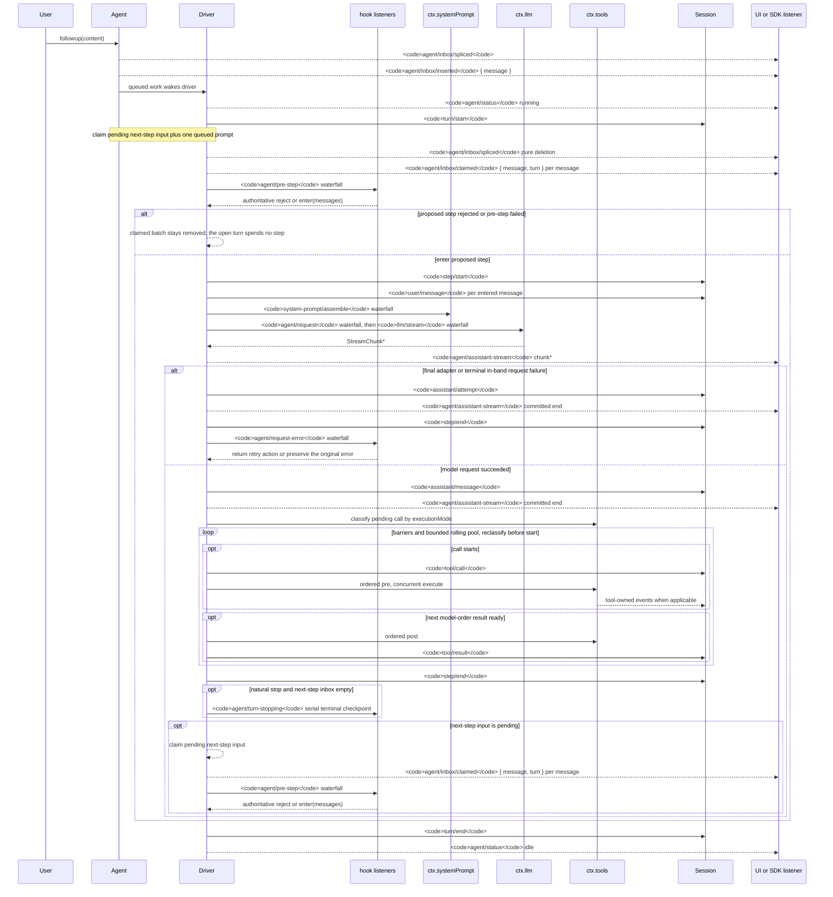

<!-- 英文源文件由 scripts/gen-doc-graphs.ts 从 scripts/agent-lifecycle-walkthrough.md 生成；本中文文件是通过双语配对维护的经评审对侧。
     更新时先改 scripts/agent-lifecycle-walkthrough.md 并运行 `pnpm run gen-doc-graphs` 更新英文，再更新本文件并运行 `pnpm run verify-translation-pairing --write docs/agent-lifecycle.md` 重新记录配对。 -->

# Agent 轮次与步骤生命周期

[English](agent-lifecycle.md) | 中文

此时序图是 [architecture.md](architecture.zh.md#turn-flow) 的配套图示。持久的回放事实保存在 `session/event` 中，实时控制与状态则保存在 `agent/*` 中。



`assistant/message` 事件会记录每次成功的提供方调用，包括返回空内容或以 `max-tokens` 结束的调用，并嵌入精确的紧凑带时间 stream。空内容不会进入派生历史。失败、重试、取消或 stream error attempt 到达 settlement 时，如果没有 surface message，就会把 stream 记录为 `assistant/attempt`。实时 `agent/assistant-stream` chunk frame 是瞬态数据；回放读取任一种持久 settlement，如果进程在 settlement 前硬中断，则不会留下持久 attempt stream。

`dsh-compaction-basic` 在派生请求之前通过 `agent/pre-step` 处理压力，而 `agent/request-error` 仅用于规范的上下文溢出。任一触发条件满足后，系统都会先执行可选的工具结果剪枝，再选择摘要。恢复发生在失败步骤结束之后、失败轮次结束之前；只有当剪枝或摘要生成推进了 surface replacement generation 时，系统才会开启一个全新的重试轮次，否则仍以原始请求错误为准。

以返回的 `agent/pre-step` 决策为准；通过包装 `next()` 的监听器会保留下游消息与 `startsRequestSeries`，除非有意替换。steering（中途引导）和注入的上下文在后续的认领操作取得其下一步骤批次后，会经过同一 waterfall（瀑布式事件）。

需要可回放 transcript（文本记录）数据的 SDK 用户应当消费 `session/event`；`agent/*` 是用于队列与状态、提示词拦截、请求构造、steering、继续执行和错误处理的实时协调接口。

<a id="reading-the-sequence"></a>

## 阅读时序图

这张图画的是：**用户说一句话之后，一次轮次（turn）里发生了什么**。时间向下流动。每一列是一个执行者在跟另一个说话。先认这九列，再按阶段走。

一个**步骤**是一次模型请求加上它调用的工具。一个**轮次**包含零个或多个步骤：它在领取首条输入之前打开，并在不再欠下任何工作时关闭。驱动器是 `dsh-agent-loop` 中的 [`ReactLoopAgent`](../packages/core/agent-loop/src/agent.ts)。调用链是 `followup` / `steer` / `inject` → `wakeDriver` → `kick` → `turn` → `preStep` → `step`。

| 箭头 | 含义 |
|---|---|
| 实线指向 **Session** | 一条持久日志事件。重新加载后仍在，`deriveMessages()`、fork、恢复和 transcript 都从它重建。 |
| 虚线指向 **SDK** | 一条实时 `agent/*` 通知。只存在于当前进程。 |
| 指向 **Hooks** / **Prompt** / **LLM**（大语言模型） / **Tools** | 一个实时扩展点：emit、waterfall 或 serial。插件在此拦截工作。 |

文档开头那句就是读图规则：要回放或画 UI，消费 `session/event`；要拦截仍在跑的轮次，听 `agent/*`。

| 参与者 | 实际是谁 |
|---|---|
| **User** | 人、ACP（Agent Client Protocol）或 headless 入口，任何调用 `agent.followup()` 的东西 |
| **Agent** | `ctx.agents` 句柄：inbox 以及 `followup` / `steer` / `inject` |
| **Driver** | `agent-loop` 里的 `ReactLoopAgent`：`kick()` → `turn()` → `step()` |
| **Hooks** | 所有听 `agent/pre-step`、`agent/request-error` 和 `agent/turn-stopping` 的插件（压缩（compaction）、plan mode、skill（技能）、Claude Code 与 Codex 钩子桥接层） |
| **Prompt** | `ctx.systemPrompt` |
| **LLM** | `ctx.llm`；提供方适配器（例如 DeepSeek）位于该服务之后 |
| **Tools** | `ctx.tools` |
| **Session** | 仅追加的会话日志。箭头指到它，就是写入可回放历史。 |
| **SDK** | Web UI 或 SDK。它们主要听实时 `agent/*` 和持久 `session/event`。 |

## 阶段 0：消息进入 inbox，叫醒驱动器

```text
User->>Agent: followup(content)
Agent-->>SDK: agent/inbox/spliced
Agent-->>SDK: agent/inbox/inserted { message }
Agent->>Driver: queued work wakes driver
Driver-->>SDK: agent/status running
```

`followup` 并不调用模型。它把一条 `UserMessage` 放进 **next-turn** 队列，并唤醒驱动器：

```text
send(message: UserMessage, target: InboxTarget, wakeup: boolean): void {
  const wakingAfterAbort = wakeup && this.phase.kind !== 'idle' && this.phase.abort.signal.aborted
  const resolvedTarget = wakingAfterAbort ? 'next-turn' : target
  this.inbox.splice(resolvedTarget, Infinity, 0, [message])
  if (wakeup) this.wakeDriver(wakingAfterAbort)
}

followup(input: UserMessage): void {
  this.send(input, 'next-turn', true)
}

steer(input: UserMessage): void {
  this.send(input, 'next-step', true)
}

inject(input: UserMessage): void {
  this.send(input, 'next-step', false)
}
```

[`send`](../packages/core/agent-loop/src/agent.ts) 是共用原语。另外两个入口图上没画额外箭头，但共用同一套 inbox：

| 方法 | 队列 | 是否唤醒驱动器 |
|---|---|---|
| `followup` | `next-turn` | 是，打开新轮次 |
| `steer` | `next-step` | 是，加入当前轮次的下一步 |
| `inject` | `next-step` | 否，等到另一条消息唤醒驱动器 |

每次 inbox 变更都先记录持久的 `agent/inbox/spliced`，再发出实时的 `agent/inbox/inserted`。SDK 可以立刻画出排队中的气泡。此时 Session 里还没有 `user/message`；该事件要等到 `agent/pre-step` enter 之后才写入。

`wakeDriver` 把 phase 从 `idle` 转为 `running`，发出 `agent/status { status: 'running' }`，并进入 `kick()` → `while (await this.turn())`。若驱动器正在 maintenance，或这次唤醒发生在 abort 之后，唤醒会被闩住，等到该活动收敛后再重放。

## 阶段 1：打开轮次，从 inbox 领取

```text
Driver->>Session: turn/start
Note: claim pending next-step input plus one queued prompt
Driver-->>SDK: agent/inbox/spliced  (pure deletion)
Driver-->>SDK: agent/inbox/claimed { message, turn }
```

驱动器在领取之前追加持久的 `turn/start`。轮次编号从这里开始。随后即使被拒绝，该事件仍留在日志中，因此一次没有模型调用的轮次仍然是一次被记录的尝试：这次尝试发生过。

领取规则在 [`Inbox.claim`](../packages/core/agent/src/inbox.ts)：

```text
claim(target: InboxTarget, turn: number): UserMessage[] {
  const claimed = this.mutate('next-step', 0, this.nextStep.length, [], false)
  if (target === 'next-turn') {
    claimed.push(...this.mutate('next-turn', 0, 1, [], false))
  }
  for (const message of claimed) this.notifications.claimed(message, turn)
  return claimed
}
```

一轮的首次领取（`target === 'next-turn'`）：

1. 排空 **全部** 待处理的 next-step 消息（先前 `inject`、`steer` 或工具结果留下的上下文）。
2. 再从 next-turn **只拿 1 条**（就是这次 `followup`）。

领取是一次纯删除：消息离开队列，所以再发一次 `agent/inbox/spliced`，然后为每条消息发出实时 `agent/inbox/claimed { message, turn }`。删了就回不去。若随后 `agent/pre-step` 拒绝，这批消息不会回到 inbox。

同一轮次的后续步骤 target 为 `next-step`，所以上面第 2 步不再发生：不会再取一条新的 `followup`。

## 阶段 2：`agent/pre-step` —— 本步能不能进模型

```text
Driver->>Hooks: agent/pre-step waterfall
Hooks-->>Driver: reject or enter(messages)
```

`agent/pre-step` 是 waterfall：每个监听器必须调用 `next()`，否则链路短路。payload 是已领取批次，加上 `turn`、`step` 和本轮的 `AbortSignal`。返回值只有两种：

- `{ kind: 'enter', messages }`：这批（可被改写）将进入本步骤
- `{ kind: 'reject' }`：本步不做

压缩、plan mode、skill 和钩子桥接层在此监听。默认的 `next()` 保留已领取消息，并可能追加 runtime context（工作区摘录等）。返回的决策为准；包装 `next()` 的监听器会保留下游消息，除非有意替换。

图上的第一个 **alt** 就是该决策。

**Reject，或首次 enter 被改写为空：**

```text
if (decision.kind === 'reject') {
  turnEnds = { kind: 'blocked' }
  return false
}
if (phase.step === 0 && decision.messages.length === 0) {
  turnEnds = { kind: 'completed' }
  return false
}
```

没有 `step/start`，也没有模型调用。`turn/start` 已经在日志里，`finally` 仍会追加 `turn/end`（`blocked` 或 `completed`）。日志记录的是：开过一轮、以零步骤结束。

**Enter** 进入阶段 3。

## 阶段 3：步骤开始，用户消息落盘，去调模型

```text
Driver->>Session: step/start
Driver->>Session: user/message
Driver->>Prompt: system-prompt/assemble
Driver->>LLM: agent/request, then llm/stream
LLM-->>Driver: StreamChunk*
Driver->>Session: assistant/chunk*
Session-->>SDK: session/event assistant/chunk*
```

enter 之后，驱动器追加 `step/start`，再为每条进入的消息追加一条持久 `user/message`。到这时 Session 才包含用户文本。模型历史来自 `session.deriveMessages()`，它读的是日志，不是 inbox。

随后运行两道 waterfall：

1. **`agent/request`**：插件可以替换提供方、模型、`maxTokens` 及其他调用配置。这道 waterfall 不能改写消息；模型可见内容必须已经在日志里。
2. **`llm/stream`**：适配器流；`llm-replay` 可以在此短路。

每个流式分片追加 `assistant/chunk`；Session 广播 `session/event`。流式 UI 跟随这些持久分片，而不是 `agent/*`。

### 图与源码：`system-prompt/assemble`

图把 `system-prompt/assemble` 画在 `user/message` 之后、紧挨着 LLM 调用。在 [`preStep()`](../packages/core/agent-loop/src/agent.ts) 中，assemble 运行在 `agent/pre-step` waterfall **之前**，也仍在 `step/start` 之前：

```text
const claimed = this.inbox.claim(target, position.turn)
const assembly = await this.loopCtx.systemPrompt.assemble(assembleContextFor(this, signal))
signal.throwIfAborted()
const sections = renderContextSections(assembly)
const context = this.runtimeContext.project(joinContextSections(sections), sections)
const decision = await this.dispatch.waterfall(
  'agent/pre-step', { messages: claimed, ...position, signal },
  (): Promise<PreStepDecision> => Promise.resolve<PreStepDecision>({
    kind: 'enter',
    messages: context === undefined ? claimed : [...claimed, context],
  }),
)
```

[architecture.md](architecture.zh.md#turn-flow) 与该源码顺序一致：claim → assemble → `agent/pre-step` → `step/start`。读 `agent.ts` 时按源码顺序。图是为了把提示词组装和模型调用画在一起，让「模型被问了什么」这一列挨着 LLM。

## 阶段 4：模型请求失败还是成功

嵌套的 **alt** 是提供方结果。

**失败支**（适配器失败、带内流出错）：

```text
step/end
agent/request-error waterfall
retry or preserve the original error
```

`dsh-llm-retry` 以及 `dsh-compaction-basic` 中的规范溢出修复挂在 `agent/request-error`。监听器在自己负责恢复时返回 `{ kind: 'retry' }` 且不调用 `next()`，否则调用 `next()` 委托下去。默认是终态失败。

### 图与源码：`agent/request-error`

图把 `step/end` 画在 `agent/request-error` 之前。在 [`step()`](../packages/core/agent-loop/src/agent.ts) 里，带内 `finish.kind === 'error' | 'aborted'` 是在同一个 `step()` 的 `while (true)` **内部**跑这道 waterfall：

```text
if (finish.kind === 'error' || finish.kind === 'aborted') {
  const action = await this.dispatch.waterfall(
    'agent/request-error', {
      turn, step, provider: request.provider,
      failure: finish.failure, retryPolicy: preparedCall?.retryPolicy, signal,
    },
    () => Promise.resolve<RequestErrorAction>(undefined),
  )
  if (action?.kind !== 'retry') {
    throw new LlmError(finish.failure.message, finish.failure.code, finish.failure)
  }
  continue
}
```

两条恢复路径：

- **步骤内重试。** `{ kind: 'retry' }` 会 `continue`。两次尝试之间没有 `step/end`。步骤编号不变。
- **抛出。** 任何其他结果都会抛出。`turn()` 在 `finally` 里追加 `step/end`，再以 `error` 结束本轮。需要全新轮次的压缩恢复发生在该失败步骤关闭之后、失败轮次关闭之前；只有剪枝或摘要推进了 surface replacement generation 时，才会开启全新的重试轮次。

**成功支：**

```text
assistant/message
classify pending call by executionMode
```

驱动器为每次成功的提供方调用追加 `assistant/message`，包括空内容和 `max-tokens`。空内容不进入 `deriveMessages()`；该事件仍保留用量和 `sourceEventSeqs`，列出对应的 `assistant/chunk` 事件，包括显式空列表。流中途取消时，已送达前缀会落成带 `interrupted: true` 的 `assistant/message`。

然后分类 assistant 消息：

- 没有 `tool-call` 块 → 本步骤完成（`completed`，若 finish 是 `max-tokens` 则为 `max-tokens`）
- 有一个或多个 `tool-call` 块 → 进入阶段 5

## 阶段 5：同一 step 内部的工具循环

```text
loop barriers and bounded rolling pool
  opt call starts
    tool/call
    ordered pre, concurrent execute
  opt next model-order result ready
    ordered post
    tool/result
```

这不是新步骤。它是 **本步骤** tool-call 块的调度器。

[`executeToolCalls`](../packages/core/agent-loop/src/tool-calls.ts) 的策略：

- **独占**调用（默认）形成屏障：前面的独占工作没完，后面的不开始。
- **并发安全**调用（`isConcurrencySafe === true`）走有界滚动池，并在每次启动前重新分类。
- **策略和结果仍按模型顺序：** `tools/pre-execute`、结果提交和 `tool/result` 保持模型顺序；工具本体可以重叠。

这与手动 `ctx.tools.execute(...)` 是同一条流水线，只是调用方换成了循环：

持久 `tool/call` → `tools/pre-execute` → `guard()` → `tools/execute` → 工具本体 → `tools/post-execute` → 实时 `tools/result` → 持久 `tool/result`

[工具流水线](tool-execution-pipeline.zh.md#reading-the-pipeline) 拥有单次调用的该顺序。[对着 `tool-calls.ts` 读](tool-execution-pipeline.zh.md#reading-tool-calls) 拥有分组、滚动池和按模型顺序提交。`Tools-->>Session: tool-owned events` 是工具自己追加的额外日志事件（`todo/write`、`fs/observed` 等）。

`tools/result` 是注册表的实时观测事件。`tool/result` 是循环随后追加的会话日志事件。结果上下文（`deferContext`、`additionalContexts`）splice 进 **next-step** inbox，在下一个步骤边界领取，而不是在这个 `step()` 里再发起一次模型调用。

随后 `step()` 返回：

- `{ kind: 'completed' }`：模型不再被欠请求（没有 tool-call，或某个工具 `concluded` 了本轮）
- `null`：工具仍欠一次请求（工具跑完后的常见情况：要把结果喂回模型）

`null` 返回值 **不会** 继续用于 `agent/request-error` 重试的内层 `while`。外层 `turn()` 循环追加 `step/end` 并打开 **下一步**。

## 阶段 6：结束本步骤，决定是否再来一步

```text
Driver->>Session: step/end
opt natural stop and next-step inbox empty
  agent/turn-stopping
opt next-step input is pending
  claim next-step
  agent/inbox/claimed
  agent/pre-step again
```

每个已进入的步骤都在 `finally` 中追加 `step/end`。然后：

```text
if (turnEnds && this.inbox.nextStep.length === 0) {
  await this.dispatch.serial('agent/turn-stopping', { turn, signal })
  signal.throwIfAborted()
}
if (turnEnds && this.inbox.nextStep.length === 0) break
target = 'next-step'
```

两种情况：

1. **自然停止且 next-step 为空。** 驱动器运行 serial 的 `agent/turn-stopping`（没有 `next()`；监听器顺序不能改变结果；有异议的监听器调用 `agent.steer(...)`，机器再读 inbox）并 `break` 出步骤循环。Claude Code 和 Codex 的 Stop 钩子在此监听。
2. **还有工作。** 工具仍欠一次请求，或 `steer` / `inject` / 工具上下文仍在 next-step。下一次 `claim` 使用 target `next-step`（不再取 next-turn 消息），并再次运行 `agent/pre-step`。这就是图底部那个 **opt**。

一次轮次可以包含步骤 1（用户文本、模型、工具），再包含步骤 2（工具结果、又一次模型请求），直到不再欠下工作。

## 阶段 7：关闭轮次，驱动器空闲

```text
Driver->>Session: turn/end
Driver-->>SDK: agent/status idle
```

`turn/end` 总在 `finally` 中与 `turn/start` 配对，并带有 `completed`、`blocked`、`max-tokens`、`aborted` 或 `error` 等原因。若 next-turn 中仍有排队的 `followup` 消息，`turn()` 返回 true，`kick()` 立即打开下一轮，SDK 可能只看到短暂的 `idle`，或者看不到。inbox 为空时发出 `agent/status { status: 'idle' }`。

对着图读源码时，打开 [`packages/core/agent-loop/src/agent.ts`](../packages/core/agent-loop/src/agent.ts)，按 `followup` → `wakeDriver` → `kick` → `turn` → `preStep` → `step` 往下找。这条路径上的每一次 `append`、`waterfall`、`serial` 都能在图上对上一条箭头。[对着生命周期读 `agent.ts`](#reading-agent-ts) 按该文件从上到下走一遍。

## 控制流摘要

```text
followup → inbox(next-turn) → wake
  turn/start
    claim(all next-step + one next-turn)
    assemble + agent/pre-step
      reject / empty → no step, still turn/end
      enter →
        step/start, user/message
        agent/request → llm/stream → assistant/chunk* → assistant/message
        on failure → step/end → agent/request-error (may retry)
        on tool-call → schedule tools → tool/call / tool/result
        step/end
        model still owed or next-step nonempty → claim → pre-step (next step, same turn)
        else → turn-stopping
  turn/end
  status idle (or the next turn immediately)
```

`on failure → step/end → agent/request-error` 这一行跟的是图。步骤内重试的源码顺序是 `agent/request-error` 然后 `continue`，中间没有 `step/end`；`step/end` 发生在 `step()` 返回或抛出时。

## 两条具体轨迹

一条没有工具调用的用户消息：

```text
followup
  agent/inbox/spliced, agent/inbox/inserted
  agent/status running
  turn/start
  claim → agent/inbox/spliced, agent/inbox/claimed
  assemble, agent/pre-step enter
  step/start, user/message
  agent/request, llm/stream, assistant/chunk*, assistant/message
  step/end
  agent/turn-stopping
  turn/end
  agent/status idle
```

同一轮次里模型点名了一个工具：

```text
... assistant/message with a tool-call block
  tool/call
  tools/pre-execute → guard → tools/execute → body → tools/post-execute
  tools/result (live), tool/result (durable)
  step/end                         // step 1
  claim next-step, agent/pre-step
  step/start, user/message         // tool context, not a new followup
  agent/request, llm/stream, assistant/chunk*, assistant/message
  step/end                         // step 2, same turn
  agent/turn-stopping
  turn/end
```

<a id="durable-vs-live"></a>

## 持久名称与实时名称

名称在 `Session.append` 写入 `SessionEventMap` 时是持久的：它留在会话日志里，重新加载后仍在（例如 `.sessions` 下）。名称在进程内由 Cordis emit 或 waterfall 时是实时扩展点：进程退出后即消失。

`session/event` 是刚追加的持久事件的实时广播总线。它本身不是日志类型。重新加载会话时从日志重建历史；它不会重放 `agent/pre-step` 或 `tools/result`。

### 持久会话事件

这些是时序图指向 Session 的实线箭头。重新加载后它们仍在日志里：

| 名称 | 记录内容 |
|---|---|
| `turn/start` / `turn/end` | 一轮的开闭。拒绝也会留下 `turn/start`；没有模型调用的轮次仍然是一次被记录的尝试。 |
| `step/start` / `step/end` | 一步的开闭：一次模型请求加上它调用的工具。 |
| `user/message` | 进入该步骤、模型会看见的一条用户角色消息。 |
| `assistant/chunk` | 一个流式分片，给回放和 UI 保真。 |
| `assistant/message` | 组装后的助手消息。派生历史读这个，不读分片。 |
| `tool/call` | 模型发起的一次工具调用，带着原始 arguments 字符串。 |
| `tool/result` | 给模型看的工具结果。 |
| `agent/inbox/spliced` | 一次规范化的 inbox 变更（插入、领取、取消）。此处的 `agent/` 前缀是持久的。 |

工具自己追加的日志事件（如 `todo/write`、`fs/observed`）属于同一类。[architecture.md](architecture.zh.md#events) 拥有事件分类（`turn/*`、`step/*`、`user/message`、`assistant/*`、`tool/*`，以及 `agent/inbox/spliced` 这类合并进来的成员）。[持久化目录](persistence-catalog.zh.md) 列出每个 `SessionEventMap` 成员。

### 实时扩展点

这些只存在于进程内。它们分属三个域：agent 协调、能力／组装，以及 `session/event` 总线。

Agent（队列、拦截、协调）：

| 名称 | 职责 |
|---|---|
| `agent/inbox/inserted` | 一条消息进入实时 inbox。SDK 可以先画排队气泡。 |
| `agent/inbox/claimed` | 一条消息在已打开的轮次内离开 inbox。 |
| `agent/status` | `idle` ⇄ `running` |
| `agent/pre-step` | waterfall：改写或拒绝已领取批次。 |
| `agent/request` | waterfall：替换调用配置。 |
| `agent/request-error` | waterfall：重试或保留失败的请求。 |
| `agent/turn-stopping` | serial：本轮即将关闭（没有 `next()`）。 |

能力和组装：

| 名称 | 职责 |
|---|---|
| `system-prompt/assemble` | waterfall：提示词片段和工具 schema。 |
| `llm/stream` | waterfall：适配器流。 |
| `tools/pre-execute` | waterfall：工具本体之前的策略。 |
| `tools/execute` | waterfall：包住工具本体。 |
| `tools/post-execute` | waterfall：接受、拦截或替换结果。 |
| `tools/result` | 注册表的实时观测，不是 `tool/result`。 |
| `session/event` | 广播刚追加的一条持久事件。 |

`followup` / `steer` / `inject`、`claim` 和 `wakeDriver` 是方法，不是事件。它们的结果落成上面这些名称。

### 两对容易混的名字

`tool/result` 是持久的；`tools/result` 是实时的。流水线先发实时 `tools/result`，循环再追加持久 `tool/result`。

`agent/inbox/spliced` 是持久的；`agent/inbox/inserted` 和 `agent/inbox/claimed` 是实时的。每次 inbox 变更先写 spliced，再发 inserted 或 claimed。进程没了之后，只能从 spliced 重建队列。

<a id="reading-agent-ts"></a>

## 对着生命周期读 `agent.ts`

[`ReactLoopAgent`](../packages/core/agent-loop/src/agent.ts) **就是**时序图里的 Driver。本节按该文件从上到下，对照上面各阶段走一遍。Mermaid 按阶段的走读和持久／实时名称列表仍在[阅读时序图](#reading-the-sequence)与[持久名称与实时名称](#durable-vs-live)；这里是同一套控制流，顺序改成源码的书写顺序。

调用链是：

`followup` / `steer` / `inject` → `send` → `wakeDriver` → `kick` → `turn` → `preStep` → `step` → `buildRequest` / `executeToolCalls`

文件里套了三层循环：

| 循环 | 代码 | 生命周期里是什么 |
|---|---|---|
| 外层 | `kick()`：`while (await this.turn())` | 一个驱动器。额外排队的 `followup` 会立刻再开一轮。`finally` 把 phase 收回 idle，并可能再次唤醒。 |
| 中层 | `turn()`：内层 `while (true)` | **同一轮**里的各步骤。第一圈 `target = 'next-turn'`；之后各圈设 `target = 'next-step'`。 |
| 内层 | `step()`：`while (true)` | **只**给 `agent/request-error` 的 `{ kind: 'retry' }` 用。不是新步骤。工具之后返回 `null` **不是**这层循环。 |

| 代码 | 生命周期阶段 |
|---|---|
| `followup` → `send(..., 'next-turn', true)` | 阶段 0：入队并唤醒。`inbox.splice` 先写持久 `agent/inbox/spliced`，再发实时 `inserted`。 |
| `steer` → next-step 且唤醒；`inject` → next-step，**不**唤醒 | 同一套 inbox。时序图不为这两条入口另画箭头。 |
| `wakeDriver` + `setPhase` | idle→running 时发 `agent/status running`，然后 `kick()`。若 phase 不是 idle（maintenance，或 abort 之后的唤醒），驱动器可能闩住 `wakeRequested`。 |
| `kick`：`while (await this.turn())` | 一个驱动器；额外排队的 followup 立刻再开一轮。`finally` → idle，可能再次唤醒。 |
| `turn`：`append('turn/start')` 然后内层 `while` | 阶段 1 打开轮次。第一圈 `target = 'next-turn'`；之后 `target = 'next-step'`。`finally` 总会写 `turn/end`。自然停止之后，inbox 仍有待处理工作则返回 true；拒绝或首次 enter 为空则直接返回 false，不再做这次检查。 |
| `preStep`：`inbox.claim` → `systemPrompt.assemble` → `agent/pre-step` waterfall | 阶段 1–2。**源码顺序不是图上的顺序：** assemble 跑在 pre-step **之前**，也仍在 `step/start` **之前**。领取：全部 next-step，且仅当 target 为 next-turn 时再取 1 条 next-turn。拒绝或首次 enter 为空 → 没有 `step/start`（`blocked` / `completed`），仍有 `turn/end`。 |
| `turn` 在 enter 之后：`step/start`、每条进入的 `user/message`、`step()` | 阶段 3 把用户消息落盘。历史是 `session.deriveMessages()`，不是 inbox。 |
| `buildRequest`：`agent/request` waterfall 然后 `llm.prepareCall` | 阶段 3 的请求配置。需要时记录 `request/header` / `request/context`。 |
| `step` 内层 `while`：`llm.stream` → `assistant/chunk*` | 阶段 3 流式输出。UI 通过 `session/event` 跟随持久分片。 |
| `finish.kind === 'error'\|'aborted'` → `agent/request-error`；`{kind:'retry'}` → `continue` | 阶段 4。**源码顺序不是图上的顺序：**步骤内重试在两次尝试之间**不**写 `step/end`。抛出 → `turn` 的 `finally` 写 `step/end`，轮次以 `error` 结束。压缩的全新重试轮次是另一条路径。 |
| 成功：`assistant/message`；没有 tool-call → `completed`；`max-tokens` 粘滞 | 阶段 4 成功支。 |
| `executeToolCalls(...)` + 把上下文 splice 进 next-step | 阶段 5。调度器在 [`tool-calls.ts`](../packages/core/agent-loop/src/tool-calls.ts)（[对着 `tool-calls.ts` 读](tool-execution-pipeline.zh.md#reading-tool-calls)）。流水线本身是 `dsh-tools`（[工具流水线](tool-execution-pipeline.zh.md#reading-the-pipeline)）。返回 `null` 表示仍欠一次模型请求 → **同一轮的下一步**，不是内层重试 `while`。 |
| `turn` 内层 `finally` 里的 `step/end`；若 `turnEnds && nextStep empty` 则 serial `agent/turn-stopping`；否则 `target='next-step'` | 阶段 6–7。 |

实时的 claimed / inserted 通知是 `Inbox` 构造函数里的回调（不是 `ReactLoopAgent` 自己的方法）。领取实现见 [`inbox.ts`](../packages/core/agent/src/inbox.ts)（`claim` / `splice`）。

### 阶段 0：入队并唤醒（`send`、`wakeDriver`、`kick`）

```text
    this.inbox = new Inbox(session, {
      inserted: (message) => { this.dispatch.emit('agent/inbox/inserted', { message }) },
      discarded: (message) => { this.dispatch.emit('agent/inbox/discarded', { message }) },
      claimed: (message, turn) => { this.dispatch.emit('agent/inbox/claimed', { message, turn }) },
    })
```

`splice` 先写持久的 `agent/inbox/spliced`，**然后**才改实时投影；回调再发实时 `inserted`（当 splice 以 `discardRemoved === true` 删消息时发 `discarded`）。领取使用 `discardRemoved === false`，所以领取是纯删除加上实时 `claimed`，不是 `discarded`。`discarded` 不是时序图上的箭头。

```text
  private setPhase(next: Phase): void {
    const previousStatus = this.status
    this.phase = next
    const status = this.status
    if (status !== previousStatus) {
      this.dispatch.emit('agent/status', { status })
    }
  }
```

`status` 在 phase 为 `idle` **或** `maintenance` 时是 `'idle'`，只有 `kind: 'running'` 才是 `'running'`。因此 `agent/status` 在 idle↔running 时发出，不会在每次 phase 字段变化时发出。

这就是图上的阶段 0：`User->>Agent: followup` → `agent/inbox/spliced` + `inserted` → `queued work wakes driver` → `agent/status running`。

```text
  send(message: UserMessage, target: InboxTarget, wakeup: boolean): void {
    // Waking input cannot join an aborted activity, so it starts the next turn.
    // Captured before the insertion so a reentrant cancel from a splice observer cannot reclassify it.
    const wakingAfterAbort = wakeup && this.phase.kind !== 'idle' && this.phase.abort.signal.aborted
    const resolvedTarget = wakingAfterAbort ? 'next-turn' : target
    this.inbox.splice(resolvedTarget, Infinity, 0, [message])
    if (wakeup) this.wakeDriver(wakingAfterAbort)
  }

  followup(input: UserMessage): void {
    this.send(input, 'next-turn', true)
  }

  steer(input: UserMessage): void {
    this.send(input, 'next-step', true)
  }

  inject(input: UserMessage): void {
    this.send(input, 'next-step', false)
  }
```

`followup` 并不调用模型。三条入口只差队列和是否唤醒：

| 方法 | 队列 | 是否唤醒驱动器 |
|---|---|---|
| `followup` | `next-turn` | 是 — 打开新轮次 |
| `steer` | `next-step` | 是 — 加入当前轮次的下一步 |
| `inject` | `next-step` | 否 — 等到另一条消息唤醒驱动器 |

`wakingAfterAbort` 在 `splice` **之前**就算好，因此 splice 观察者里重入的 `cancel` 不能改写 target。对着已 abort 的活动到来的唤醒消息会被强制放到 `next-turn`；它不能作为 `next-step` 加入已 abort 的工作。

```text
  private wakeDriver(wakeAfterAbort = false): void {
    if (this.phase.kind !== 'idle') {
      // Maintenance and aborted drivers cannot deliver the wake: latch it for
      // replay at convergence. Live drivers claim queued work themselves;
      // disposal never latches, so teardown waits on no model turn.
      const reason = this.phase.abort.signal.reason as AgentCancelCause | undefined
      if (reason?.kind !== 'disposed' && (this.phase.kind === 'maintenance' || wakeAfterAbort)) {
        this.phase.wakeRequested = true
      }
      return
    }
    const driver = Promise.withResolvers<void>()
    this.activityDone = driver.promise
    this.setPhase({
      kind: 'running',
      abort: new AbortController(),
      turn: this.phase.lastTurn,
      step: 0,
      wakeRequested: false,
    })
    this.loopCtx.agents.withInitiator(this, () => this.kick()).then(driver.resolve, driver.reject)
  }
```

`wakeDriver` 在 phase **不是** idle 时有三种情况：

- **活着的 `running`，尚未 abort。** 方法直接返回，不闩住。活着的驱动器自己领取队列（`turn()` 返回 true，或已打开轮次内的 next-step claim）。
- **maintenance，或 abort 之后的唤醒，且取消原因不是 `disposed`。** 设置 `wakeRequested = true`。该活动收敛时重放（`kick` 的 `finally`，或 `runMaintenance` 的 `finally`）。
- **`disposed`。** 永不闩住，因此拆卸不会再等一轮模型轮次。

在 **idle** 时发来的唤醒总会打开一轮边界（即使消息随后被清掉）。只有闩住的重放会在 `inbox.hasPending` 已经为 false 时被抑制。

```text
  private async kick(): Promise<void> {
    try {
      while (await this.turn()) {}
    } catch (_error) {
      // Reported failures and cancellation are contained at the driver boundary.
    } finally {
      /* v8 ignore next -- kick owns a running phase until this driver boundary */
      if (this.phase.kind === 'running') {
        const { turn, wakeRequested } = this.phase
        this.setPhase({ kind: 'idle', lastTurn: turn })
        if (wakeRequested && this.inbox.hasPending) this.wakeDriver()
      }
    }
  }
```

`kick` 是外层循环：不断调用 `turn()`，直到它返回 false（inbox 空，或本轮结束时没有把驱动器交给下一轮）。抛出的失败在这里被收住；`throwError` 已经在失败点发出了实时 `agent/error`。`finally` 在 phase 仍是 `running` 时发布 `agent/status idle`，若 inbox 仍有工作则重放闩住的唤醒。

### 阶段 1–2：打开轮次、领取、`agent/pre-step`（`turn`、`preStep`）

`turn()` 在步骤循环 **之前** 追加 `turn/start`。轮次编号在这里递增。随后即使被拒绝，该事件仍留在日志中。

```text
    const turn = phase.turn + 1
    try {
      this.session.append('turn/start', { turn })
    } catch (error: unknown) {
      this.throwError(error)
    }
    phase.turn = turn
    let turnEnds: TurnEndReason | null = null
    let target: InboxTarget = 'next-turn'
    try {
      while (true) {
        signal.throwIfAborted()
        const step = phase.step + 1
        const decision = await this.preStep(target, { turn, step })
        if (decision.kind === 'reject') {
          turnEnds = { kind: 'blocked' }
          return false
        }
        if (turnEnds && decision.messages.length === 0) break
        // A removed waking message or an enter decision rewritten to empty
        // still owns the initial turn boundary, but it spends no model call.
        if (phase.step === 0 && decision.messages.length === 0) {
          turnEnds = { kind: 'completed' }
          return false
        }
```

第一圈：`target === 'next-turn'`。之后各圈（某步没有结束本轮之后）设 `target = 'next-step'`。这就是图底部那个 **opt**。

领取和组装都在 `preStep()` 里跑，不在 `step()` 里：

```text
    const claimed = this.inbox.claim(target, position.turn)
    const assembly = await this.loopCtx.systemPrompt.assemble(assembleContextFor(this, signal))
    signal.throwIfAborted()
    const sections = renderContextSections(assembly)
    const context = this.runtimeContext.project(joinContextSections(sections), sections)
    const decision = await this.dispatch.waterfall(
      'agent/pre-step', { messages: claimed, ...position, signal },
      (): Promise<PreStepDecision> => Promise.resolve<PreStepDecision>({
        kind: 'enter',
        messages: context === undefined ? claimed : [...claimed, context],
      }),
    )
    signal.throwIfAborted()
    return decision.kind === 'reject' ? decision : { ...decision, assembly }
```

这段对应图上：`turn/start` → claim → `agent/inbox/claimed` → `agent/pre-step` → reject 或 enter。

`Inbox.claim` 排空 **全部** 待处理的 next-step 消息，并且 **仅当** `target === 'next-turn'` 时再取 **1 条** next-turn。领取是一次纯删除：再发一条持久 `agent/inbox/spliced`，然后为每条消息发实时 `agent/inbox/claimed { message, turn }`。若随后 `agent/pre-step` 拒绝，已删的消息不会回到 inbox。

默认的 `next()` 保留已领取消息，并可能追加投影出的 runtime context。返回的决策为准。

**Reject：** `turnEnds = { kind: 'blocked' }`，`return false`。没有 `step/start`。`finally` 仍会追加 `turn/end`。

**首次 enter 为空**（`phase.step === 0` 且 `messages.length === 0`）：`turnEnds = { kind: 'completed' }`，`return false`。同样：记录了轮次、零步骤、没有模型调用。

**`turnEnds` 已有值时的后续空 enter：** `break` 出步骤循环，不再打开另一步。这条路径不是图上多画的箭头；它是「某步已完成、循环仍继续、随后发现被改写成空的批次」时的停止方式。

这就是阶段 3 已经写过的第一处图／源码差：图把 `system-prompt/assemble` 画在 `user/message` 之后；源码顺序是 claim → assemble → `agent/pre-step` → 然后才 `step/start`。[architecture.md](architecture.zh.md#turn-flow) 与源码顺序一致。

### 阶段 3：进入步骤、用户消息落盘、调用模型

enter 之后继续在 `turn()` 里：

```text
        signal.throwIfAborted()
        this.session.append('step/start', { turn, step })
        phase.step = step
        try {
          for (const message of decision.messages) {
            this.session.append('user/message', message, { surfaceOp: 'append' })
          }
          // max-tokens is sticky: once any step hits the ceiling, later steps
          // that complete normally must not downgrade the turn outcome.
          const stepEnd = await this.step(decision.assembly)
          // max-tokens stays sticky: a later completed step must not
          // downgrade the turn outcome.
          if (turnEnds === null || turnEnds.kind !== 'max-tokens') turnEnds = stepEnd
        } finally {
          this.session.append('step/end', { turn, step })
        }
```

只有 enter 之后 Session 才包含用户文本。`phase.step` 在这里递增，因此拒绝或首次 enter 为空时不会占用步骤号。

随后 `step()`：

| 代码 | 图上的箭头 |
|---|---|
| `buildRequest()` → `agent/request` waterfall | `Driver->>LLM: agent/request` |
| `llm.prepareCall` / `preparedCall?.stream(request) ?? this.loopCtx.llm.stream(request)` | `llm/stream` |
| 每个流式分片 `append('assistant/chunk')` | `assistant/chunk*` + `session/event` |

模型历史是 `this.session.deriveMessages()`，读的是日志，不是 inbox。

```text
    while (true) {
      const { request, preparedCall } = await this.buildRequest(
        turn, step, assembly.tools, system, this.session.deriveMessages(), signal,
      )
      const assembler = new BlockAssembler()
      const chunkSeqs: number[] = []
      try {
        const stream = preparedCall?.stream(request) ?? this.loopCtx.llm.stream(request)
        signal.throwIfAborted()
        for await (const chunk of stream) {
          signal.throwIfAborted()
          chunkSeqs.push(this.session.append('assistant/chunk', { turn, step, chunk }).seq)
          assembler.push(chunk)
        }
        signal.throwIfAborted()
      } catch (error: unknown) {
        if (signal.aborted) {
          const content = assembler.interruptedBlocks()
          if (content.length > 0) {
            this.session.append('assistant/message', {
              turn,
              step,
              message: createAssistantMessage({
                content,
                source: { provider: request.provider, model: request.model },
              }),
              interrupted: true,
              ...assembler.usage === undefined ? {} : { usage: assembler.usage },
            }, { surfaceOp: 'append', sourceEventSeqs: chunkSeqs })
          }
        }
        throw error
      }
```

流中途取消时，若已送达前缀非空，会落成带 `interrupted: true` 的 `assistant/message`，然后重新抛出。`kick` 收住这次抛出；若 signal 已 abort，`turn` 的 `catch` 记录 `turnEnds = { kind: 'aborted', reason }`。

`buildRequest` 是阶段 3 里请求配置的那一半：

```text
    const proposedConfig = await this.dispatch.waterfall(
      'agent/request', { turn, step, signal },
      () => Promise.resolve(seedConfig),
    )
```

这道 waterfall 不能改写消息。之后若缺少 `provider` / `model` 会抛出。`llm.prepareCall` 绑定适配器默认值；本方法吞掉的唯一 `LlmError` 是 `NO_ADAPTER`，此时留下 `config = proposedConfig`，给中间件提供的未注册路由用。

随后在本实例第一次调用时追加持久 `request/header`（`initial` 或 `resume`），以及之后 header 变化时再追加；当 `provider`、`model` 或 `contextWindow` 与上一次 context 不同时追加持久 `request/context`。这两个事件名不是图上的箭头；它们是把冻结请求锚进日志的方式。冻结请求携带 `messages: boundaryMessages`（`deriveMessages()`）、可选的 `system` / `tools`、`sessionId` 和 `signal`。

### 阶段 4：失败还是成功（`step()` 内层循环）

带内 `finish.kind === 'error' | 'aborted'` 在 **同一个** `step()` 的 `while (true)` **内部**跑 `agent/request-error`：

```text
      const finish = assembler.finish
      if (finish.kind === 'error' || finish.kind === 'aborted') {
        const action = await this.dispatch.waterfall(
          'agent/request-error', {
            turn,
            step,
            provider: request.provider,
            failure: finish.failure,
            retryPolicy: preparedCall?.retryPolicy,
            signal,
          },
          () => Promise.resolve<RequestErrorAction>(undefined),
        )
        signal.throwIfAborted()
        if (action?.kind !== 'retry') {
          throw new LlmError(finish.failure.message, finish.failure.code, finish.failure)
        }
        continue
      }
```

这是第二处图／源码差：图把 `step/end` 画在 `agent/request-error` 之前。源码是：

- `{ kind: 'retry' }` → `continue`。两次尝试之间 **没有** `step/end`。步骤编号不变。
- 任何其他结果 → `throw`。`turn()` 的内层 `finally` 写 `step/end`，然后 `turn` 的 `catch` 把 `turnEnds` 设为 `error`（若 signal 已 abort 则为 `aborted`），`throwError` 发出 `agent/error`。需要全新轮次的压缩恢复发生在该失败步骤关闭之后、失败轮次关闭之前；那条路径不是这个内层 `while`。

成功时为每次成功的提供方调用追加 `assistant/message`，包括空内容。空内容不进入 `deriveMessages()`；该事件仍保留用量和 `sourceEventSeqs`。`finish.kind === 'max-tokens'` 在检查 tool-call 块 **之前** 返回 `{ kind: 'max-tokens' }`，因此 max-tokens 结束不会进入 `executeToolCalls`。`turn()` 让 `max-tokens` 粘滞：随后的 `{ kind: 'completed' }` 不得把 `turnEnds` 降级。

```text
      const message = createAssistantMessage({
        content: assembler.blocks(),
        source: {
          provider: request.provider,
          model: request.model,
          ...assembler.replayState !== undefined ? { replayState: assembler.replayState } : {},
        },
      })
      this.session.append(
        'assistant/message',
        {
          turn,
          step,
          message,
          ...assembler.usage === undefined ? {} : { usage: assembler.usage },
        },
        { surfaceOp: 'append', sourceEventSeqs: chunkSeqs },
      )
      if (finish.kind === 'max-tokens') return { kind: 'max-tokens' }

      const toolCalls = message.content.filter(block => block.type === 'tool-call')
      if (toolCalls.length === 0) return { kind: 'completed' }
      const { concluded } = await executeToolCalls(
        this.loopCtx, turn, step, toolCalls, signal,
        context => this.inbox.splice('next-step', this.inbox.nextStep.length, 0, [context]),
      )
      return concluded ? { kind: 'completed' } : null
```

没有 `tool-call` 块 → `{ kind: 'completed' }`（阶段 4 成功，跳过阶段 5）。有一个或多个 `tool-call` 块 → 阶段 5。

### 阶段 5：工具，仍在本步骤内

图上的 **loop**（屏障／滚动池、`tool/call`、`tool/result`）在 [`tool-calls.ts`](../packages/core/agent-loop/src/tool-calls.ts) 里，不在 `agent.ts`。执行流水线本身是 `dsh-tools`；见[阅读流水线](tool-execution-pipeline.zh.md#reading-the-pipeline)。[对着 `tool-calls.ts` 读](tool-execution-pipeline.zh.md#reading-tool-calls) 走一遍该文件。

`acceptContext` 回调把每条已提交的结果上下文 splice 到 next-step 的 **末尾**（`start = this.inbox.nextStep.length`，`deleteCount = 0`）。这些上下文在 **下一个** 步骤边界领取，而不是在这个 `step()` 里再发起一次模型调用。

`executeToolCalls` 返回 `{ concluded }`。任一已提交结果带有 `concludesTurn` 时 `concluded` 为 true。随后 `step()` 返回：

- `{ kind: 'completed' }` — 模型不再被欠请求（没有 tool-call，或某个工具 concluded 了本轮）
- `null` — 工具仍欠一次请求（工具跑完后的常见情况：要把结果喂回模型）

返回 `null` **不会** 继续用于 `agent/request-error` 重试的内层 `while`。外层 `turn()` 循环走到 `finally`（`step/end`），并且因为 `turnEnds` 是 `null`（除非先前某步已经粘住 `max-tokens`），既不跑 `agent/turn-stopping` 也不 `break`。它把 `target` 设为 `'next-step'`，打开 **同一轮的下一步**。

### 阶段 6–7：关闭步骤、可能再开一步、关闭轮次

`step()` 返回之后，`turn()` 仍握着内层 `finally`：每个已进入的步骤都会追加 `step/end`，然后：

```text
        signal.throwIfAborted()
        if (turnEnds && this.inbox.nextStep.length === 0) {
          await this.dispatch.serial('agent/turn-stopping', { turn, signal })
          signal.throwIfAborted()
        }
        if (turnEnds && this.inbox.nextStep.length === 0) break
        target = 'next-step'
      }
    } catch (error: unknown) {
      if (signal.aborted) {
        turnEnds = { kind: 'aborted', reason: signal.reason as AgentCancelCause }
        throw error
      }
      // Every failure is structured: an `LlmError` keeps its facts, anything
      // else flattens to `errorChain` text under the `UNKNOWN` code.
      turnEnds = {
        kind: 'error',
        error: error instanceof LlmError
          ? error.failure
          : { message: errorChain(error), code: 'UNKNOWN' },
      }
      this.throwError(error)
    } finally {
      try {
        // oxlint-disable-next-line typescript/no-non-null-assertion -- every exit assigns a turn ending
        this.session.append('turn/end', { turn, reason: turnEnds! })
      } catch (error: unknown) {
        this.throwError(error)
      }
    }
    if (!this.inbox.hasPending) return false
    phase.abort = new AbortController()
    // A fresh controller makes a latch set on the old one stale: the live driver claims the queue itself.
    phase.wakeRequested = false
    phase.step = 0
    return true
```

| 代码 | 图 |
|---|---|
| 内层 `finally` 里的 `step/end` | 每个已进入步骤都会关 |
| serial 的 `agent/turn-stopping` | **opt** 自然停止；没有 `next()` |
| `target = 'next-step'` 再 `preStep` | 图底部那个 **opt** claim |
| 外层 `finally` 里总有 `turn/end` | 与 `turn/start` 配对 |
| `turn()` 返回 `true` | 自然停止之后 next-turn 仍待处理；`kick()` 立刻再开一轮 |
| `kick()` 的 `finally` 里 `setPhase(idle)` | `agent/status idle` |

`agent/turn-stopping` 仅在 `turnEnds` 已经有值 **并且** next-step 为空时运行。有异议的监听器调用 `agent.steer(...)`；机器在第二个 `if` 再读 inbox（若此时 next-step 非空，就不会 `break`）。Claude Code 和 Codex 的 Stop 钩子在此监听。

`catch` 在 `finally` 写 `turn/end` 之前区分 abort 与结构化失败。拒绝／首次 enter 为空时的 `return false` 仍会跑这个 `finally`。

`turn()` 返回 `true` 时，它换掉 abort controller、清掉过期闩、把 `step` 重置为 0，并把 `phase.turn` 留在刚关闭的那一轮，好让下一次 `turn()` 再递增。驱动器保持 `running`；SDK 可能在这些轮次之间看不到 `idle`。

### 时序图没有画出的方法

这些方法在同一个文件里，会影响驱动器，但不是图上的箭头：

| 方法 | 职责 |
|---|---|
| `cancel(cause, options)` | 除非 `keepInbox`，否则 `inbox.clear()`（先清空 next-step 再清空 next-turn 的持久 splice）并 `wakeRequested = false`。若不是 idle，则 `abort.abort(cause)`。 |
| `runMaintenance(job)` | 仅在 idle 时合法。设 `kind: 'maintenance'`（status 仍报告 `idle`）。`finally` 回到 idle，若 `wakeRequested && hasPending` 则可能 `wakeDriver()`。 |
| `whenIdle()` | 等到 `activityDone` 稳定（await 期间没有更新的驱动器或 maintenance 替换它）。 |
| `throwError(error)` | 发出实时 `agent/error { turn, step, error }`，然后抛出。`kick` 的 `catch` 收住这次抛出。 |
| `status` getter | `idle` 和 `maintenance` 为 `'idle'`；只有 running phase 为 `'running'`。 |

`requestProposal` 在插件于 `agent/request` 里看见种子配置之前，剥掉适配器拥有的 `reasoningEffort` / `maxTokens` 标志。它不是一个生命周期阶段。

### 对着文件往下读的顺序

1. 构造函数：融合的 `dispatch`、`Inbox` 实时回调、从日志里最后一条 `turn/start` 得到的 `lastTurn`、初始 `idle` phase、agent 作用域的 `scope` / `ctx`。
2. `followup`（调用 `send`）→ `send` → `wakeDriver`。
3. `kick` → `turn`。
4. `preStep`：claim + assemble + `agent/pre-step`。
5. `turn` 在 enter 之后：`step/start` / `user/message` → `step`。
6. `buildRequest`：`agent/request`、`prepareCall`、可选的 `request/header` / `request/context`；然后 stream / chunk / `assistant/message`。
7. `executeToolCalls`；`null` 回到 `turn()` 开下一步。
8. `turn-stopping` → `turn/end` → 若 inbox 仍有待处理工作，`turn()` 返回 true。

Mermaid 按阶段的表格和两条具体轨迹见[阅读时序图](#reading-the-sequence)；本节是同一套事实，按文件顺序排列。

维护模式：英文源文件包含人工维护的 Mermaid 时序图与源码对照详解，并由生成器写出；本中文文件作为经评审对侧通过双语配对维护。确切的事件签名位于生成的 Cordis 目录中。
