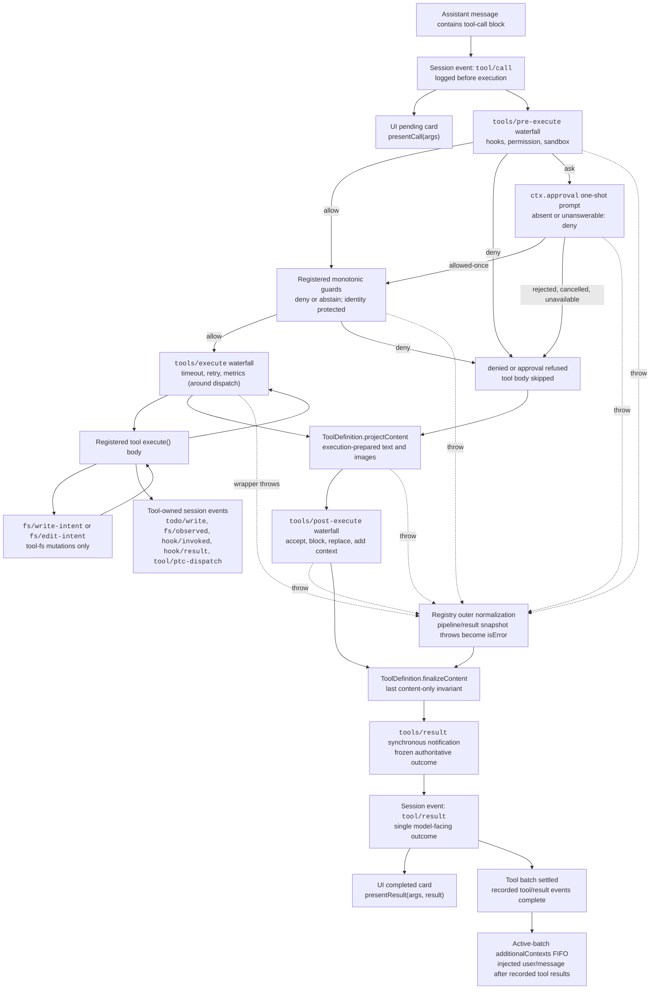

<!-- Generated by scripts/gen-doc-graphs.ts - do not edit by hand.
     Run `pnpm run gen-doc-graphs` to regenerate. -->

# Tool Execution Pipeline

This graph shows where policy, hooks, sandboxing, filesystem guards, result rewriting, final-outcome observation, and UI rendering run without changing the loop. The `tools/pre-execute` waterfall runs first, monotonic guards run next, and the `tools/execute` and `tools/post-execute` waterfalls follow; the three waterfalls may transform a call. Definition-owned `projectContent` installs prepared content before post-execute; `finalizeContent` and `tools/result` run afterward.



Filesystem read-before-edit checks stay below `tool-fs` on `fs/*` events. Generic pre/post waterfalls host hooks and approval policy; `ctx.approval` resolves asks before monotonic guards, and owner policy that must not be reordered remains a registered guard. Around-dispatch concerns such as timeouts wrap `tools/execute`. The registry losslessly snapshots the candidate result and normalizes a snapshot failure before the visible definition's snapshotted `finalizeContent` callback enforces its synchronous content-only invariant. `tools/result` then observes the immutable, lossless-JSON outcome. This lets hooks span tool families without coupling the tools to one policy service. PTC mode sends both the reserved `run_code` transport and its serialized sub-calls through the pipeline; sub-calls carry the parent token, log `tool/ptc-dispatch`, return denials as binding rejections, and omit `additionalContexts` to preserve call/result adjacency.

<a id="reading-the-pipeline"></a>

## Reading the pipeline

This diagram is **one tool call** inside the registry, not a whole turn. The agent loop only: appends durable `tool/call`, calls `ctx.tools.execute()`, then appends durable `tool/result`. Policy, approval, timeouts, rewriting, and observation live in [`dsh-tools`](../packages/core/tools/src/index.ts) and do not change `agent-loop`.

The [lifecycle sequence](agent-lifecycle.md#reading-the-sequence) owns when the loop starts a call and when it commits the result. This page owns what happens between those two session events.

| Edge | Meaning |
|---|---|
| Solid `allow` / `deny` / `ask` | A normal `PreToolDecision` or guard outcome. |
| Dashed `throw` | A listener, approval call, guard, or around-wrapper threw. The call becomes an `isError` result and **skips** `tools/post-execute`. |
| `toolBody → around` | The `tools/execute` waterfall wraps the body: control enters `around`, `next()` runs the body, control returns to `around`, then `around → post`. |

The live order is three transformable waterfalls (`tools/pre-execute` → `tools/execute` → `tools/post-execute`), then definition-owned `finalizeContent`, then observe-only `tools/result`. The loop then writes durable `tool/result`.

[`ToolRuntime.execute`](../packages/core/tools/src/index.ts) is `prepare` then `complete`. The loop scheduler in [`executeToolCalls`](../packages/core/agent-loop/src/tool-calls.ts) splits the same stages so `tools/pre-execute` stays in model order while bodies may overlap: `prepare` (pre-execute and guards) → `dispatch` (`tools/execute` and the body) → `finalize` (`tools/post-execute`, `finalizeContent`, `tools/result`). [Reading `tool-calls.ts`](#reading-tool-calls) walks that scheduler.

## From the model to about-to-execute

**`model` → `toolCall` → `presentCall` / `pre`**

An assistant message contains one or more `tool-call` blocks. For each started call the loop appends durable `tool/call` **before** execution, with the raw arguments string the model produced:

```text
function appendToolCall(session: Session, turn: number, step: number, block: ToolCallBlock): number {
  const event = session.append('tool/call', { turn, step, callId: block.id, name: block.name, arguments: block.arguments })
  return event.seq
}
```

The UI pending card is `presentCall(args)`, a pure function of those arguments. It is not a Cordis event and does not sit on the execution path.

`tool/call` is already in the log, so replay still shows that the model named this tool even when the user rejects, a guard denies, or the body never runs.

Under `code` (not `both`), a model-direct call naming any visible tool other than reserved `run_code` becomes `UNKNOWN_TOOL` in `createExecution`, **before** `tools/pre-execute`, approval `ask`, and guards. SDK sub-dispatches carry the outer `parent` token and are exempt.

## `tools/pre-execute`

Default `next()` is `{ kind: 'allow' }`. Every listener must call `next()` or the chain short-circuits. The return is only:

```text
export type PreToolDecision =
  | { kind: 'allow' }
  | { kind: 'deny'; reason: string }
  | { kind: 'ask'; reason?: string }
```

| Decision | Diagram edge | Next |
|---|---|---|
| `allow` | `pre → guards` | Monotonic guards. |
| `deny` | `pre → denied` | Skip the body; still run `post-execute`. |
| `ask` | `pre → approval` | One-shot `ctx.approval`. |

Hooks, permission, and sandbox policy listen here. The waterfall **must not rewrite `exec.arguments`**: logged and presented arguments have to match what will run.

A throwing listener takes the dashed edge `pre -.-> normalized`: the call becomes an error result and **does not** run `post-execute`.

[`prepareExecution`](../packages/core/tools/src/index.ts) after a ready execution:

```text
const gate = await this.ctx.waterfall(
  carrier, 'tools/pre-execute', exec,
  () => Promise.resolve<PreToolDecision>({ kind: 'allow' }),
)
const askResolution: ToolAskResolution = gate.kind === 'ask'
  ? await this.serviceAsk(exec, gate)
  : { decision: gate, approvalCancelled: false }
const { decision } = askResolution
const denialReason = decision.kind === 'allow'
  ? this.guardReason(exec)
  : decision.reason
if (denialReason !== undefined) {
  return await next({
    kind: 'post-result',
    exec,
    result: this.materializeFinalResult({
      content: [{ type: 'text', text: `Error: ${denialReason}` }],
      isError: true,
      error: { message: denialReason },
    }),
  })
}
```

`kind: 'post-result'` means the scheduler still runs `post-execute`. A throw in this `try` returns `kind: 'final-result'` and skips `post-execute`.

## `ctx.approval`

`ask` calls `ctx.approval` once. No `ApprovalService`, no agent on the call, or an unanswerable channel all degrade to deny. [`serviceAsk`](../packages/core/tools/src/index.ts) maps the seam one-to-one:

```text
switch (outcome) {
  case 'allowed-once': return { decision: { kind: 'allow' }, approvalCancelled: false }
  case 'rejected': return {
    decision: { kind: 'deny', reason: `the user rejected tool "${exec.name}"` },
    approvalCancelled: false,
  }
  case 'cancelled': return {
    decision: { kind: 'deny', reason: `approval for tool "${exec.name}" was cancelled` },
    approvalCancelled: true,
  }
  case 'unavailable': return {
    decision: { kind: 'deny', reason: `tool "${exec.name}" requires approval, but no approval channel is available` },
    approvalCancelled: false,
  }
}
```

| Outcome | Diagram edge |
|---|---|
| `allowed-once` | `approval → guards` (this call only, then guards still run) |
| `rejected` / `cancelled` / `unavailable` | `approval → denied` |
| approval throws | dashed into `normalized` |

`ctx.approval` resolves **before** monotonic guards. Ask is a reorderable pre-execute decision; a guard is owner policy that later waterfalls cannot turn back into allow.

## Monotonic guards

`ctx.tools.guard()` registers a synchronous `(execution) => string | undefined`. A string is a final denial reason. `undefined` abstains and leaves the decision unchanged. Global guards run first, then agent-scoped layers.

```text
guardReason(exec: ToolExecution): string | undefined {
  for (const guard of this.guards.values()) {
    const reason = guard(exec)
    if (reason !== undefined) return reason
  }
  return undefined
}
```

- `guards → around`: allow, enter `tools/execute`
- `guards → denied`: deny, skip the body
- guard throws: dashed into `normalized`

**Monotonic** means a denial here cannot be turned back into permission by `tools/execute` or `tools/post-execute`. Identity-protected owner policy belongs on a guard, not on the reorderable pre-execute waterfall.

## `denied`

Reject, approval non-grant, and guard denial all reach `denied → post`.

`definition.execute()` does **not** run. The model still receives an error-shaped result (`Error: <reason>`) so the next request can see that the call did not succeed. The path still runs `post-execute` → `finalizeContent` → `tools/result`, so hooks can rewrite the message, attach context, or keep the invariant that every call has a final outcome.

## `tools/execute`

This is the around-dispatch waterfall. `next()` is `dispatchToolBody`, which resolves the definition and `await tool.execute(exec.arguments, exec)`. Timeout, retry, and metrics plugins wrap here. Wrappers may change only `exec.signal`; call identity stays immutable. The registry re-fuses the original caller abort before the body, so a wrapper cannot detach caller cancellation.

```text
const result = await this.ctx.waterfall(
  carrier, 'tools/execute', mutableExec,
  () => this.dispatchToolBody(mutableExec),
)
```

- `around → toolBody`: `next()` enters the body
- `around → post`: after the body (and around wrappers) settle, the normalized result goes to post
- wrapper throws: dashed `around -.-> normalized`, **skip post**

The diagram edge `toolBody → around` is that wrap: control goes in through around and comes back out through around.

Cancellation never abandons a started body: a started promise reaches quiescence before the outcome becomes `ABORTED`. If the body was never invoked, the code is aborted-before-dispatch.

## Tool body, filesystem intents, and tool-owned events

**`toolBody`** is `defineTool({ execute })`. It returns only the canonical JSON value declared by the output schema and stops cooperatively through `exec.signal`. The registry snapshots, schema-validates, and freezes that value, then `output.render` (and optional `presentationMeta`) produce the model-facing `content` (and UI `meta`).

**`fsGate` (`toolBody ⇄ fsGate`)** applies only to `tool-fs` mutations: `fs/write-intent` or `fs/edit-intent`. Read-before-edit checks stay on `fs/*` under `tool-fs`, not on generic `tools/pre-execute`. The two-way edge means the body may hit those intent events while it runs, then continue.

**`owned`** are extra durable session events the tool itself appends during `execute()`, such as `todo/write`, `fs/observed`, `hook/invoked`, `hook/result`, and `tool/code-dispatch`. They are a separate log stream from the pipeline decision. The loop still appends one enclosing `tool/result` afterward.

## `tools/post-execute`

After the body (or a denial that produced an error result), `post-execute` sees the normalized candidate. Default `next()` is `{ kind: 'accept' }`. Thrown tool bodies still reach this waterfall as errors. Pipeline throws that already took the dashed edge do not.

```text
export type PostToolDecision =
  | { kind: 'accept'; content?: ContentBlock[]; value?: never; additionalContexts?: UserMessage[] }
  | { kind: 'accept'; value: JsonValue; content?: never; additionalContexts?: UserMessage[] }
  | { kind: 'block'; feedback: ContentBlock[]; additionalContexts?: UserMessage[] }
```

[`postExecute`](../packages/core/tools/src/index.ts):

- **`block`** turns the call into `isError` whose `content` is the corrective `feedback`. Context deferred by the tool body is discarded; a block exposes only `additionalContexts` the blocking decision supplied.
- **`accept` with `value`** replaces the canonical success value (and re-renders). It cannot replace the value of a failed result, and it cannot set both `value` and `content` on one decision.
- **`accept` with `content`** replaces only model-facing content.
- Either accept or block may attach `additionalContexts`, concatenated after any contexts already on the result (for accept).

Content replacement is not a confidentiality boundary: block or replace the value when programmatic consumers must not receive it.

A throwing post-execute listener takes the dashed edge into `normalized`.

Denied calls still enter post-execute, so a hook can attach a model-readable explanation of a human "no".

## `normalized`

Every dashed `throw` joins here: pre-execute, approval, guard, around wrapper, or post-execute.

The registry losslessly snapshots the failure as `isError: true`. Those paths often **already skipped** `post-execute` (pre or around throw). `finalizeContent` and `tools/result` **still run** — once per normalized result, including outer pipeline failures.

## `finalizeContent`

Optional. Snapshotted when the call starts (`visible?.finalizeContent?.bind(visible)` in `createExecution`), so replacing the registered definition later does not change this call.

[`applyFinalContent`](../packages/core/tools/src/index.ts):

```text
const finalizeContent = this.contentFinalizers.get(exec)
if (finalizeContent === undefined) return result
const content = finalizeContent(exec, result)
return content === undefined ? result : { ...result, content }
```

It must be **synchronous** and total. It may replace only `content`, not `value` or `isError`. It runs for ordinary success, denial, and pipeline failure. After this, `finishScheduledExecution` materializes again, freezes the execution, and notifies. Observers cannot mutate the outcome.

## `tools/result` vs `tool/result`

**`final` (`tools/result`)** is the registry's live `emit`. The execution and result are frozen. Listener failures are contained and logged; they cannot corrupt the outcome. The event is gone after the process exits.

**`toolResult` (`tool/result`)** is the durable session event the loop appends **after** `tools/result`. The next model request, the completed UI card, and replay all follow this log event:

```text
function appendToolResult(
  session: Session,
  turn: number,
  step: number,
  block: ToolCallBlock,
  result: ToolExecutionResult,
  callSeq: number,
): void {
  const message = createToolResultMessage({
    callId: block.id,
    content: result.content,
    isError: result.isError,
  })
  session.append('tool/result', {
    turn, step,
    message,
    ...result.error?.info ? { error: result.error.info } : {},
    // The tool's private presentation payload (e.g. a result-time diff),
    // persisted so a UI bridge reproduces the card on replay.
    ...result.meta !== undefined ? { meta: result.meta } : {},
  }, { surfaceOp: 'append', sourceEventSeqs: [callSeq] })
}
```

`tools/*` is live; `tool/*` is durable. Same pair as on [agent-lifecycle.md](agent-lifecycle.md#durable-vs-live).

**`presentResult`** is `presentResult(args, result)`, a pure function for the completed card.

[`notifyResult`](../packages/core/tools/src/index.ts) freezes `exec` then dispatches `tools/result`:

```text
Object.freeze(exec)
const callbacks = this.ctx.events.dispatch('emit', [
  scopeTarget(this, exec.agent), 'tools/result', exec, result,
])
```

## After the batch: `additionalContexts`

**`allResults` → `context`**

One assistant message may contain several tool-call blocks. The loop commits `tool/result` in **model order** even when concurrent bodies finish out of order (`commitReady` in `tool-calls.ts`). After recorded `tool/result` events for the batch are complete, `additionalContexts` (and `deferContext` from the body) splice into the **next-step** inbox in FIFO order.

They become later `user/message` events. They do **not** start another model call inside this `step()`. That is the lifecycle trailing opt: tool context is claimed at the next step boundary.

Code Mode sub-calls omit per-sub-call `additionalContexts` on the child result and defer them through the parent `run_code` outcome so logged call/result pairs stay adjacent. Sub-calls re-enter this same pipeline with the parent's token, log `tool/code-dispatch`, and surface denials as binding `ToolCallError` rejections. The [tools README](../packages/core/tools/README.md#code-mode) owns that contract.

## The shortest happy path

Allow, no denial, no throw:

```text
assistant message contains tool-call
  durable tool/call
  UI presentCall(args)
  tools/pre-execute allow
  guards abstain or allow
  tools/execute around
    definition.execute() body
    optional fs/* intents, optional tool-owned session.append
  tools/post-execute accept
  finalizeContent if registered
  live tools/result
  durable tool/result
  UI presentResult(args, result)
  batch settled → additionalContexts into next-step
```

The deny path forks at `denied`: the body does not run; from `post` onward it joins the success path and still produces `tools/result` and `tool/result`.

The throw path forks on a dashed edge: it skips `post-execute` and joins again at `normalized` → `finalizeContent`.

<a id="reading-tool-calls"></a>

## Reading `tool-calls.ts`

[`executeToolCalls`](../packages/core/agent-loop/src/tool-calls.ts) is the lifecycle diagram's **stage 5** scheduler, not the pipeline itself. [`step()`](../packages/core/agent-loop/src/agent.ts) hands it every `tool-call` block from a successful assistant message. This file decides **who starts when** and **in what order results hit the log**. Policy, approval, timeouts, and the tool body live in `dsh-tools` ([Reading the pipeline](#reading-the-pipeline)).

```text
      const toolCalls = message.content.filter(block => block.type === 'tool-call')
      if (toolCalls.length === 0) return { kind: 'completed' }
      const { concluded } = await executeToolCalls(
        this.loopCtx, turn, step, toolCalls, signal,
        context => this.inbox.splice('next-step', this.inbox.nextStep.length, 0, [context]),
      )
      return concluded ? { kind: 'completed' } : null
```

A manual `ctx.tools.execute(...)` runs `prepare` then `complete` on one call. The loop needs **ordered** `tools/pre-execute` and **overlapping** bodies, so it uses the internal `TOOL_RUNTIME_SCHEDULER` and splits the same stages:

| Scheduler method | What it is on the pipeline diagram |
|---|---|
| `prepare` | After durable `tool/call`: `tools/pre-execute`, approval, guards |
| `dispatch` | `tools/execute` around the body |
| `finalize` | `tools/post-execute` → `finalizeContent` → live `tools/result` |
| `finish` | **Skips** `post-execute`; still runs `finalizeContent` and `tools/result` (dashed `throw` after prepare/around) |

This file writes durable `tool/call` / `tool/result` and, in model order, calls `acceptContext`. It does not implement the waterfalls.

`ctx.agents.requireInitiator()` is the Agent that `wakeDriver` installed with `withInitiator`. Each planned `exec.agent` is that initiator.

Read three mechanisms: **grouping**, **start versus commit**, **abort versus scheduler failure**.

### Outer loop: `executeToolCalls` cuts groups at barriers

```text
  let next = 0
  let concluded = false
  while (next < planned.length) {
    // Commit before classifying again so registry changes affect unstarted calls.
    // oxlint-disable-next-line typescript/no-non-null-assertion -- bounded by the loop condition
    const first = planned[next]!
    const mode = ctx.tools.executionMode(first.exec).kind
    const group = mode === 'parallel' ? planned.slice(next) : [first]
    const outcome = await runGroup(
      ctx, turn, step, group, mode, signal, acceptContext,
    )
    next += outcome.consumed
    concluded ||= outcome.concluded
    if (outcome.aborted) {
      for (const call of planned.slice(next)) appendSkippedToolCall(session, turn, step, call.block)
      return { concluded }
    }
  }
  return { concluded }
```

`executionMode` is fail-closed: `isConcurrencySafe(args) === true` is `parallel`; undeclared, hidden, unknown, invalid, or throwing classifiers are `exclusive`.

- **Exclusive:** `group = [first]`. That one call is a barrier; the next call is not classified until this group returns.
- **Parallel:** `group` is the suffix from `next`. `runGroup` may stop early when a later call reclassifies to exclusive; `consumed` is then `started`, and that exclusive call becomes the next outer barrier.

`parseArguments` parses the model's raw JSON string for scheduling (`isConcurrencySafe` and the body). Invalid JSON is kept as text; an empty string becomes `{}`. Durable `tool/call.arguments` is still the raw string.

`acceptContext` is the `agent.ts` splice: each committed result's `additionalContexts` appends onto the **end** of next-step (`start = this.inbox.nextStep.length`, `deleteCount = 0`). They do not start another model call inside this `step()`.

The only return is `{ concluded }`. It is true when any committed result carried `concludesTurn`. `step()` then returns `{ kind: 'completed' }`; otherwise `null`, and the same turn opens another step to feed tool results back to the model.

On abort, `consumed` is `group.length` (the whole group, including skipped unstarted calls). The outer loop then `appendSkippedToolCall` for every later group that never ran.

### Inner loop: `runGroup` is a rolling pool plus ordered commit

Four counters:

| Variable | Meaning |
|---|---|
| `nextToStart` | Next index that has not yet entered `startCall` |
| `started` | How many durable `tool/call` events this group has written |
| `inFlight` | Promises for calls currently in `dispatch` |
| `committed` | How many `tool/result` events have been written in model order |

**Invariant: `committed` advances only across contiguous model-order slots.** If index 1 finishes first, `commitReady` waits until index 0 is in `slots` before writing 1. That is the diagram's "ordered post / `tool/result`".

`maxParallelToolCalls` is read once at the start of each `runGroup` from `ctx.agentLoop.config` (default [`DEFAULT_MAX_PARALLEL_TOOL_CALLS`](../packages/core/agent-loop/src/constants.ts) `10`; `1` is fully serial). A settings write caps the **next** group; the group already in flight keeps the cap it destructured.

#### `startCall`

```text
  const startCall = async (index: number): Promise<void> => {
    // oxlint-disable-next-line typescript/no-non-null-assertion -- bounded index
    const call = group[index]!
    callSeqs[index] = appendToolCall(session, turn, step, call.block)
    started++
    const prepared = await ctx.tools[TOOL_RUNTIME_SCHEDULER].prepare(call.exec)
    throwSchedulerFailure()
    switch (prepared.kind) {
      case 'dispatch': {
        const promise = ctx.tools[TOOL_RUNTIME_SCHEDULER].dispatch(prepared.exec).then(
          (outcome) => {
            slots[index] = { exec: prepared.exec, result: outcome.result, needsPost: outcome.kind === 'post-result' }
            return index
          },
          (error: unknown) => {
            schedulerFailure ??= { error }
            return index
          },
        )
        inFlight.set(index, promise)
        break
      }
      case 'post-result':
        slots[index] = { exec: prepared.exec, result: prepared.result, needsPost: true }
        break
      case 'final-result':
        slots[index] = { exec: prepared.exec, result: prepared.result, needsPost: false }
        break
      /* v8 ignore next -- closed-union exhaustiveness guard */
      default:
        assertNever(prepared, 'tool-call scheduler prepare result')
    }
  }
```

Order is fixed:

1. Write durable `tool/call` **first** (replay still shows the model named this tool if a later deny skips the body).
2. `prepare` (ordered pre-execute; approval may await here).
3. `dispatch` puts the body in `inFlight`. `post-result` / `final-result` fill `slots` immediately and do not occupy the pool.

`prepare` is ordered, so a parallel group still runs pre-execute one call after another. Only dispatch/body overlaps.

A `dispatch` rejection **fulfills** the in-flight promise with the index and latches `schedulerFailure` without filling `slots[index]`. The next `throwSchedulerFailure()` throws. That started call keeps its `tool/call` and never gets a fabricated `tool/result`.

#### `fillPool`

```text
  const fillPool = async (): Promise<void> => {
    while (!aborted && nextToStart < group.length && inFlight.size < maxParallelToolCalls) {
      // Re-read later modes after ordered commits so registry changes can create a barrier.
      // oxlint-disable-next-line typescript/no-non-null-assertion -- bounded by the loop condition
      const nextCall = group[nextToStart]!
      if (nextToStart > 0 && mode === 'parallel'
        && ctx.tools.executionMode(nextCall.exec).kind !== 'parallel') break
      await startCall(nextToStart)
      nextToStart++
      throwSchedulerFailure()
      await commitReady()
      throwSchedulerFailure()
      // Abort may arrive while pre-execute awaits.
      if (signal.aborted) aborted = true
    }
  }
```

- Pool size is `maxParallelToolCalls`.
- **Reclassify before each later start.** If this group began as parallel and the next call is now exclusive, `break`. The current pool drains; that exclusive call is left for the outer loop's next barrier.
- After each start, `commitReady()` may already write a synchronous deny (`post-result` / `final-result`) in model order.

The main loop is `fillPool` → `Promise.race` on `inFlight` → `commitReady` → `fillPool` again. That is the bounded rolling pool. Ordered pre-execute may await; only dispatch/body overlaps.

#### `commitReady`

```text
  const commitReady = async (): Promise<void> => {
    while (committed < group.length) {
      const slot = slots[committed]
      if (slot === undefined) break
      const call = group[committed]
      const result = slot.needsPost
        ? await ctx.tools[TOOL_RUNTIME_SCHEDULER].finalize(slot.exec, slot.result)
        : ctx.tools[TOOL_RUNTIME_SCHEDULER].finish(slot.exec, slot.result)
      // oxlint-disable-next-line typescript/no-non-null-assertion -- bounded index
      appendToolResult(session, turn, step, call!.block, result, callSeqs[committed]!)
      for (const context of result.additionalContexts ?? []) acceptContext(context)
      concluded ||= result.concludesTurn === true
      committed++
    }
  }
```

If `slots[committed]` is still `undefined`, stop: a later call that already finished waits. `needsPost === true` runs `finalize` (includes `post-execute`); `false` runs `finish` (skips `post-execute`). Then durable `tool/result`, with `sourceEventSeqs` pointing at that call's `tool/call`.

### Two exits: abort versus scheduler failure

**Abort** (`signal.aborted`): stop starting new calls, drain and commit started ones in order, then write synthetic errors for **unstarted** calls in this group (`appendSkippedToolCall`: `tool/call` then `tool/result` with `TOOL_ABORTED_BEFORE_DISPATCH`, text `Error: tool call aborted before dispatch`). The outer loop does the same for later groups. Replay has a call/result pair for every model-named tool.

**Scheduler failure** (`prepare` / `finalize` throw, or `dispatch` latches `schedulerFailure`): stop new dispatches, `Promise.allSettled` already-started dispatches, then **throw without fabricating** `tool/result` for uncommitted calls. Already-written `tool/call` events stay. Abort completes the transcript; an internal failure does not pretend a tool returned.

After a non-throwing `runGroup`:

- Abort: `{ consumed: group.length, aborted: true, concluded }`.
- Ordinary end: `{ consumed: started, aborted: false, concluded }`. `started` may be less than `group.length` when a parallel group `break`s on reclassification. `committed === started` must hold; otherwise the scheduler throws `tool-call scheduler: uncommitted settled calls`.

### File order

1. Module comment: exclusive barriers, bounded parallel, policy/results still model-ordered.
2. `executeToolCalls`: cut groups.
3. `runGroup`: `startCall` → `fillPool` → race `inFlight` → `commitReady`.
4. `appendToolCall` / `appendToolResult` / `appendSkippedToolCall`: the only Session writes in this file.

Two short traces:

**One exclusive tool**

```text
executeToolCalls
  group = [that call]
  tool/call
  prepare (pre-execute → guards)
  dispatch (body)
  finalize (post → live tools/result)
  durable tool/result
  additionalContexts → next-step
  return { concluded: false }  →  agent.ts opens the next step
```

**Two parallel-safe tools, model order A then B, B's body finishes first**

```text
start A (ordered pre) → dispatch A
start B (ordered pre) → dispatch B
B body settles → slots[1] filled; commitReady still waits for slots[0]
A settles → tool/result A, then tool/result B
```

[Reading the pipeline](#reading-the-pipeline) owns one call's pre / execute / post. This section owns how one step's calls share that pipeline.

Maintenance mode: curated Mermaid flow and source-mapped walkthrough; exact tool schemas and event signatures live in generated catalogs.
