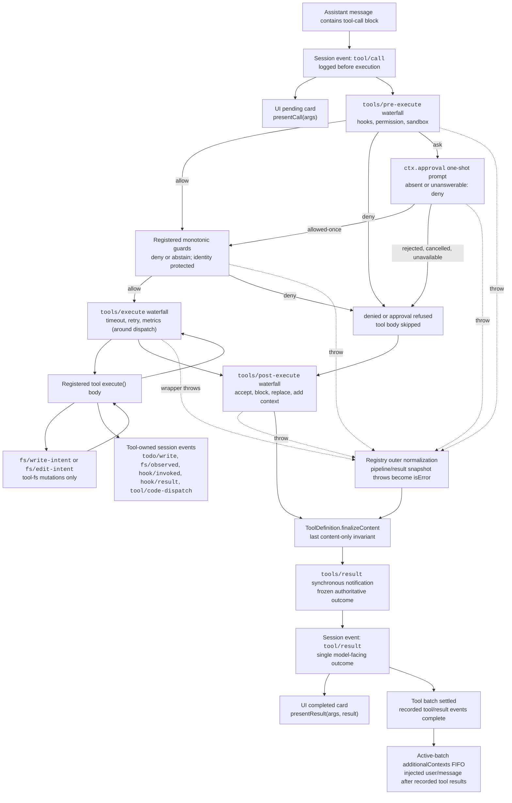

<!-- 英文源文件由 scripts/gen-doc-graphs.ts 从 scripts/tool-execution-pipeline-walkthrough.md 生成；本中文文件是通过双语配对维护的经评审对侧。
     更新时先改 scripts/tool-execution-pipeline-walkthrough.md 并运行 `pnpm run gen-doc-graphs` 更新英文，再更新本文件并运行 `pnpm run verify-translation-pairing --write docs/tool-execution-pipeline.md` 重新记录配对。 -->

# 工具执行流水线

[English](tool-execution-pipeline.md) | 中文

此图展示策略、钩子、沙箱、文件系统守卫、结果重写、最终结果观察和 UI 渲染在不改变循环的情况下何时运行。`tools/pre-execute` waterfall（瀑布式事件）首先运行，随后是单调守卫，然后运行 `tools/execute` 和 `tools/post-execute` waterfall；这三个 waterfall 可以改写一次调用。由定义自身控制的 `finalizeContent` 和 `tools/result` 在此之后运行。



文件系统的先读后编辑检查位于 `tool-fs` 之下，通过 `fs/*` 事件实现。通用的前置／后置 waterfall 承载钩子与审批策略；`ctx.approval` 在单调守卫之前处理询问，而不得重新排序的所有者策略仍作为已注册的守卫。超时等环绕分发关注点对 `tools/execute` 进行包装。注册表会对候选结果进行无损快照；如果快照失败，则会先将失败规范化，之后再由可见定义中已随快照固定的 `finalizeContent` 回调强制执行其同步且仅限内容的不变式。随后，`tools/result` 会观察不可变、可由 JSON 无损表示的结果。这样一来，钩子便可跨越不同工具系列，而无需让工具与某个策略服务耦合。PTC mode 会将保留的 `run_code` 传输及其序列化子调用都送入流水线；子调用携带父级 token、记录 `tool/code-dispatch`、将拒绝呈现为具有约束力的驳回，并省略 `additionalContexts`，以保持调用与结果相邻。

<a id="reading-the-pipeline"></a>

## 阅读流水线

这张图画的是注册表里的**一次工具调用**，不是整一轮。agent loop 只做三件事：追加持久的 `tool/call`、调用 `ctx.tools.execute()`、再追加持久的 `tool/result`。策略、审批、超时、改写和观察都在 [`dsh-tools`](../packages/core/tools/src/index.ts) 里，不改 `agent-loop`。

[生命周期时序图](agent-lifecycle.zh.md#reading-the-sequence) 负责循环何时启动一次调用、何时提交结果。本页负责这两条会话事件之间发生了什么。

| 边 | 含义 |
|---|---|
| 实线 `allow` / `deny` / `ask` | 一次正常的 `PreToolDecision` 或守卫结果。 |
| 虚线 `throw` | 监听器、审批调用、守卫或 around 包装层抛错。这次调用变成 `isError` 结果，并且 **跳过** `tools/post-execute`。 |
| `toolBody → around` | `tools/execute` waterfall 包住本体：控制流进入 `around`，`next()` 跑本体，再回到 `around`，然后 `around → post`。 |

实时顺序是三道可改写的 waterfall（`tools/pre-execute` → `tools/execute` → `tools/post-execute`），然后是定义自己的 `finalizeContent`，然后是只观察的 `tools/result`。循环再写持久的 `tool/result`。

[`ToolRuntime.execute`](../packages/core/tools/src/index.ts) 是先 `prepare` 再 `complete`。循环调度器 [`executeToolCalls`](../packages/core/agent-loop/src/tool-calls.ts) 把同一套阶段拆开，好让 `tools/pre-execute` 保持模型顺序、本体可以重叠：`prepare`（pre-execute 和守卫）→ `dispatch`（`tools/execute` 和本体）→ `finalize`（`tools/post-execute`、`finalizeContent`、`tools/result`）。[对着 `tool-calls.ts` 读](#reading-tool-calls) 走一遍该调度器。

## 从模型到即将执行

**`model` → `toolCall` → `presentCall` / `pre`**

一条助手消息里可以有一个或多个 `tool-call` 块。对每个开始的调用，循环在执行**之前**追加持久的 `tool/call`，参数是模型吐出的原始 JSON 字符串：

```text
function appendToolCall(session: Session, turn: number, step: number, block: ToolCallBlock): number {
  const event = session.append('tool/call', { turn, step, callId: block.id, name: block.name, arguments: block.arguments })
  return event.seq
}
```

UI 的进行中卡片是 `presentCall(args)`，它是这些参数的纯函数。它不是 Cordis 事件，也不在执行路径上。

`tool/call` 已经在日志里，所以即使用户拒绝、守卫拒绝、或本体从未运行，回放仍能看到模型点过这个工具名。

在 `code`（不是 `both`）下，模型直呼保留的 `run_code` 以外任何可见工具，会在 `createExecution` 里变成 `UNKNOWN_TOOL`，发生在 `tools/pre-execute`、审批 `ask` 和守卫**之前**。SDK 子分发携带外层 `parent` token，不受此限。

## `tools/pre-execute`

默认的 `next()` 是 `{ kind: 'allow' }`。每个监听器必须调用 `next()`，否则链路短路。返回值只有：

```text
export type PreToolDecision =
  | { kind: 'allow' }
  | { kind: 'deny'; reason: string }
  | { kind: 'ask'; reason?: string }
```

| 决策 | 图上的边 | 接下来 |
|---|---|---|
| `allow` | `pre → guards` | 单调守卫。 |
| `deny` | `pre → denied` | 跳过本体；仍走 `post-execute`。 |
| `ask` | `pre → approval` | 一次性的 `ctx.approval`。 |

钩子、权限和沙箱策略挂在这里。这道 waterfall **不得改写 `exec.arguments`**：已经记入日志和呈现的参数必须与真正要跑的那份一致。

监听器抛错走虚线 `pre -.-> normalized`：这次调用变成错误结果，并且 **不** 跑 `post-execute`。

就绪执行之后的 [`prepareExecution`](../packages/core/tools/src/index.ts)：

```text
const gate = await this.ctx.waterfall(
  carrier, 'tools/pre-execute', exec,
  () => Promise.resolve<PreToolDecision>({ kind: 'allow' }),
)
const askResolution: ToolAskResolution = gate.kind === 'ask'
  ? await this.serviceAsk(exec, gate)
  : { decision: gate, approvalCancelled: false }
const { decision } = askResolution
const denialReason = decision.kind === 'allow'
  ? this.guardReason(exec)
  : decision.reason
if (denialReason !== undefined) {
  return await next({
    kind: 'post-result',
    exec,
    result: this.materializeFinalResult({
      content: [{ type: 'text', text: `Error: ${denialReason}` }],
      isError: true,
      error: { message: denialReason },
    }),
  })
}
```

`kind: 'post-result'` 表示调度器仍会跑 `post-execute`。这个 `try` 里抛错则返回 `kind: 'final-result'`，并跳过 `post-execute`。

## `ctx.approval`

`ask` 会调用一次 `ctx.approval`。没有 `ApprovalService`、调用上没有 agent、或通道不可回答，都退化成拒绝。[`serviceAsk`](../packages/core/tools/src/index.ts) 把该 seam 一一映射：

```text
switch (outcome) {
  case 'allowed-once': return { decision: { kind: 'allow' }, approvalCancelled: false }
  case 'rejected': return {
    decision: { kind: 'deny', reason: `the user rejected tool "${exec.name}"` },
    approvalCancelled: false,
  }
  case 'cancelled': return {
    decision: { kind: 'deny', reason: `approval for tool "${exec.name}" was cancelled` },
    approvalCancelled: true,
  }
  case 'unavailable': return {
    decision: { kind: 'deny', reason: `tool "${exec.name}" requires approval, but no approval channel is available` },
    approvalCancelled: false,
  }
}
```

| 结果 | 图上的边 |
|---|---|
| `allowed-once` | `approval → guards`（只放行这一次，然后仍过守卫） |
| `rejected` / `cancelled` / `unavailable` | `approval → denied` |
| 审批抛错 | 虚线进 `normalized` |

`ctx.approval` 在单调守卫**之前**解析。ask 是可重排的 pre-execute 决策；守卫是后面的 waterfall 不能再改回允许的所有者策略。

## 单调守卫

`ctx.tools.guard()` 注册同步的 `(execution) => string | undefined`。字符串是终态拒绝理由。`undefined` 表示弃权，保持原决定。先跑全局守卫，再跑 agent 作用域层。

```text
guardReason(exec: ToolExecution): string | undefined {
  for (const guard of this.guards.values()) {
    const reason = guard(exec)
    if (reason !== undefined) return reason
  }
  return undefined
}
```

- `guards → around`：放行，进入 `tools/execute`
- `guards → denied`：拒绝，跳过本体
- 守卫抛错：虚线进 `normalized`

**单调**意味着这里的拒绝不能被 `tools/execute` 或 `tools/post-execute` 改回允许。受身份保护的所有者策略属于守卫，不属于可重排的 pre-execute waterfall。

## `denied`

拒绝、审批未授予、守卫拒绝都到达 `denied → post`。

`definition.execute()` **不会**运行。模型仍会收到错误形态的结果（`Error: <reason>`），好让下一次请求看到这次没有成功。路径仍会跑 `post-execute` → `finalizeContent` → `tools/result`，因此钩子可以改写文案、附加上下文，或维持「每次调用都有最终结果」这条不变量。

## `tools/execute`

这是 around-dispatch waterfall。`next()` 是 `dispatchToolBody`，它解析定义并 `await tool.execute(exec.arguments, exec)`。超时、重试和指标插件包在这里。包装层只能改 `exec.signal`；调用身份保持不可变。注册表会在进本体前把调用方的 abort 再熔进去，所以包装层没法把取消摘掉。

```text
const result = await this.ctx.waterfall(
  carrier, 'tools/execute', mutableExec,
  () => this.dispatchToolBody(mutableExec),
)
```

- `around → toolBody`：`next()` 进入本体
- `around → post`：本体（以及 around 包装）结束后，规范化结果去 post
- 包装层抛错：虚线 `around -.-> normalized`，**跳过 post**

图上的边 `toolBody → around` 就是这种包装：控制流从 around 进去，再从 around 出来。

取消从不丢弃已经启动的本体：已启动的 promise 会到达静止，结果才变成 `ABORTED`。若本体从未被调用，错误码是 aborted-before-dispatch。

## 工具本体、文件系统意图、工具自有事件

**`toolBody`** 就是 `defineTool({ execute })`。它只返回 output schema 声明的规范 JSON 值，并通过 `exec.signal` 协作停止。注册表会快照、按 schema 校验并冻结该值，然后 `output.render`（以及可选的 `presentationMeta`）产生面向模型的 `content`（和 UI 的 `meta`）。

**`fsGate`（`toolBody ⇄ fsGate`）** 只适用于 `tool-fs` 的变更：`fs/write-intent` 或 `fs/edit-intent`。先读后编辑检查留在 `tool-fs` 之下的 `fs/*` 上，不在通用的 `tools/pre-execute` 上。双向边表示本体运行过程中可能碰到这些意图事件，然后继续跑。

**`owned`** 是工具在 `execute()` 期间自己追加的额外持久会话事件，例如 `todo/write`、`fs/observed`、`hook/invoked`、`hook/result`、`tool/code-dispatch`。它们与流水线决策是两条日志流。循环随后仍会再追加一条总的 `tool/result`。

## `tools/post-execute`

本体跑完（或拒绝产生了错误结果）之后，`post-execute` 看到的是规范化候选结果。默认 `next()` 是 `{ kind: 'accept' }`。抛错的工具本体仍会作为错误进入这道 waterfall。已经走了虚线的流水线抛错不会进来。

```text
export type PostToolDecision =
  | { kind: 'accept'; content?: ContentBlock[]; value?: never; additionalContexts?: UserMessage[] }
  | { kind: 'accept'; value: JsonValue; content?: never; additionalContexts?: UserMessage[] }
  | { kind: 'block'; feedback: ContentBlock[]; additionalContexts?: UserMessage[] }
```

[`postExecute`](../packages/core/tools/src/index.ts)：

- **`block`** 把这次调用变成 `isError`，其 `content` 是纠正用的 `feedback`。工具本体延迟的上下文会被丢弃；block 只暴露该拒绝决策自己提供的 `additionalContexts`。
- **带 `value` 的 `accept`** 替换规范成功值（并重新 render）。它不能替换失败结果的 value，也不能在一次决策里同时设置 `value` 和 `content`。
- **带 `content` 的 `accept`** 只替换面向模型的内容。
- accept 或 block 都可以附加 `additionalContexts`；对 accept 来说，会接在结果上已有上下文之后。

替换内容不是保密边界：当编程消费方不得接收某个值时，应阻止或替换该值。

抛错的 post-execute 监听器走虚线进入 `normalized`。

被拒绝的调用仍会进入 post-execute，因此钩子可以给「人点了否」补一句模型能读懂的说明。

## `normalized`

每条虚线 `throw` 都汇到这里：pre-execute、审批、守卫、around 包装层或 post-execute。

注册表会把这次失败无损快照成 `isError: true`。这些路径常常**已经跳过** `post-execute`（pre 或 around 抛错）。`finalizeContent` 和 `tools/result` **仍然会跑**——每个规范化结果恰好一次，包括外层流水线失败。

## `finalizeContent`

可选。调用开始时快照（`createExecution` 里的 `visible?.finalizeContent?.bind(visible)`），所以之后换掉已注册定义也不会影响这一次。

[`applyFinalContent`](../packages/core/tools/src/index.ts)：

```text
const finalizeContent = this.contentFinalizers.get(exec)
if (finalizeContent === undefined) return result
const content = finalizeContent(exec, result)
return content === undefined ? result : { ...result, content }
```

它必须是**同步**且对所有输入都有定义。它只能替换 `content`，不能改 `value` 或 `isError`。普通成功、拒绝和流水线失败都会走到它。此后 `finishScheduledExecution` 再次实体化、冻结这次执行并通知。观察方不能改结果。

## `tools/result` 与 `tool/result`

**`final`（`tools/result`）** 是注册表的实时 `emit`。执行对象和结果已冻结。监听器失败会被隔离并记日志，不能把结果改坏。进程退出后这个事件就没了。

**`toolResult`（`tool/result`）** 是循环在 `tools/result` **之后**追加的持久会话事件。下一次模型请求、完成态 UI 卡片和回放都以这条日志为准：

```text
function appendToolResult(
  session: Session,
  turn: number,
  step: number,
  block: ToolCallBlock,
  result: ToolExecutionResult,
  callSeq: number,
): void {
  const message = createToolResultMessage({
    callId: block.id,
    content: result.content,
    isError: result.isError,
  })
  session.append('tool/result', {
    turn, step,
    message,
    ...result.error?.info ? { error: result.error.info } : {},
    // The tool's private presentation payload (e.g. a result-time diff),
    // persisted so a UI bridge reproduces the card on replay.
    ...result.meta !== undefined ? { meta: result.meta } : {},
  }, { surfaceOp: 'append', sourceEventSeqs: [callSeq] })
}
```

`tools/*` 是实时的；`tool/*` 是持久的。与 [agent-lifecycle.md](agent-lifecycle.zh.md#durable-vs-live) 上那一对相同。

**`presentResult`** 是 `presentResult(args, result)`，完成卡片的纯函数。

[`notifyResult`](../packages/core/tools/src/index.ts) 先冻结 `exec` 再分发 `tools/result`：

```text
Object.freeze(exec)
const callbacks = this.ctx.events.dispatch('emit', [
  scopeTarget(this, exec.agent), 'tools/result', exec, result,
])
```

## 一批结束之后：`additionalContexts`

**`allResults` → `context`**

一条助手消息里可以有多个 tool-call 块。即使并发本体的完成顺序乱了，循环仍按**模型顺序**提交 `tool/result`（`tool-calls.ts` 里的 `commitReady`）。本批已记录的 `tool/result` 都完成后，`additionalContexts`（以及本体里的 `deferContext`）按 FIFO 顺序 splice 进 **next-step** inbox。

它们会变成后续的 `user/message` 事件。它们**不会**在这个 `step()` 里再发起一次模型调用。这就是生命周期图末尾那个 opt：工具上下文在下一个步骤边界领取。

Code Mode 子调用不会把每条子调用的 `additionalContexts` 放在子结果上，而是经父级 `run_code` 结果延迟，好让日志里的 call/result 仍然相邻。子调用带着父级 token 重新进入同一条流水线、记录 `tool/code-dispatch`、并把拒绝呈现为有约束力的 `ToolCallError` 驳回。该约定由 [tools README](../packages/core/tools/README.zh.md#code-mode) 拥有。

## 最短成功路径

放行、无拒绝、无抛错：

```text
assistant message contains tool-call
  durable tool/call
  UI presentCall(args)
  tools/pre-execute allow
  guards abstain or allow
  tools/execute around
    definition.execute() body
    optional fs/* intents, optional tool-owned session.append
  tools/post-execute accept
  finalizeContent if registered
  live tools/result
  durable tool/result
  UI presentResult(args, result)
  batch settled → additionalContexts into next-step
```

拒绝路径在 `denied` 处岔开：本体不跑；从 `post` 起与成功路径汇合，仍然产生 `tools/result` 和 `tool/result`。

抛错路径在虚线上岔开：跳过 `post-execute`，在 `normalized` → `finalizeContent` 再汇合。

<a id="reading-tool-calls"></a>

## 对着 `tool-calls.ts` 读

[`executeToolCalls`](../packages/core/agent-loop/src/tool-calls.ts) 是生命周期图里 **阶段 5** 的调度器，不是流水线本身。[`step()`](../packages/core/agent-loop/src/agent.ts) 把一次成功助手消息里的每个 `tool-call` 块交给它。这个文件决定 **谁何时开始**，以及 **结果按什么顺序写入日志**。策略、审批、超时和工具本体都在 `dsh-tools` 里（[阅读流水线](#reading-the-pipeline)）。

```text
      const toolCalls = message.content.filter(block => block.type === 'tool-call')
      if (toolCalls.length === 0) return { kind: 'completed' }
      const { concluded } = await executeToolCalls(
        this.loopCtx, turn, step, toolCalls, signal,
        context => this.inbox.splice('next-step', this.inbox.nextStep.length, 0, [context]),
      )
      return concluded ? { kind: 'completed' } : null
```

一次手动 `ctx.tools.execute(...)` 对单次调用先 `prepare` 再 `complete`。循环需要 **有序** 的 `tools/pre-execute` 和可以 **重叠** 的本体，因此走内部的 `TOOL_RUNTIME_SCHEDULER`，把同一套阶段拆开：

| 调度器方法 | 流水线图上是什么 |
|---|---|
| `prepare` | 持久 `tool/call` 写完之后：`tools/pre-execute`、审批、守卫 |
| `dispatch` | `tools/execute` 包住本体 |
| `finalize` | `tools/post-execute` → `finalizeContent` → 实时 `tools/result` |
| `finish` | **跳过** `post-execute`；仍跑 `finalizeContent` 和 `tools/result`（prepare/around 之后的虚线 `throw`） |

这个文件写持久 `tool/call` / `tool/result`，并按模型顺序调用 `acceptContext`。它不实现 waterfall。

`ctx.agents.requireInitiator()` 是 `wakeDriver` 用 `withInitiator` 装上的那个 Agent。每条 planned `exec.agent` 都是该发起方。

读时盯三个机制：**分组**、**启动与提交拆开**、**abort 与调度失败两条退出**。

### 外层：`executeToolCalls` 按屏障切组

```text
  let next = 0
  let concluded = false
  while (next < planned.length) {
    // Commit before classifying again so registry changes affect unstarted calls.
    // oxlint-disable-next-line typescript/no-non-null-assertion -- bounded by the loop condition
    const first = planned[next]!
    const mode = ctx.tools.executionMode(first.exec).kind
    const group = mode === 'parallel' ? planned.slice(next) : [first]
    const outcome = await runGroup(
      ctx, turn, step, group, mode, signal, acceptContext,
    )
    next += outcome.consumed
    concluded ||= outcome.concluded
    if (outcome.aborted) {
      for (const call of planned.slice(next)) appendSkippedToolCall(session, turn, step, call.block)
      return { concluded }
    }
  }
  return { concluded }
```

`executionMode` 是失败即独占：`isConcurrencySafe(args) === true` 才是 `parallel`；未声明、隐藏、未知、非法或抛错的分类器都是 `exclusive`。

- **独占：** `group = [first]`。这一条形成屏障；本组返回之前不会分类下一条。
- **并行：** `group` 是从 `next` 起的后缀。`runGroup` 在后面某条重新分类成独占时可以提前停；此时 `consumed` 是 `started`，那条独占调用成为外层下一道屏障。

`parseArguments` 把模型的原始 JSON 字符串解析出来供调度使用（`isConcurrencySafe` 和本体）。坏 JSON 原样留下；空串变成 `{}`。持久 `tool/call.arguments` 仍是原始字符串。

`acceptContext` 就是 `agent.ts` 那个 splice：每条已提交结果的 `additionalContexts` 接到 next-step 的 **末尾**（`start = this.inbox.nextStep.length`，`deleteCount = 0`）。它们不在这个 `step()` 里再发起一次模型调用。

返回值只有 `{ concluded }`。任一已提交结果带有 `concludesTurn` 则为 true。随后 `step()` 返回 `{ kind: 'completed' }`；否则 `null`，同一轮再开一步把工具结果喂回模型。

abort 时 `consumed` 是 `group.length`（整组，含被跳过的未启动调用）。外层再对从未跑过的后续各组调用 `appendSkippedToolCall`。

### 内层：`runGroup` 是滚动池加上有序提交

四个计数：

| 变量 | 含义 |
|---|---|
| `nextToStart` | 下一个还没进入 `startCall` 的下标 |
| `started` | 本组已经写下多少条持久 `tool/call` |
| `inFlight` | 当前正在 `dispatch` 的 promise |
| `committed` | 已经按模型顺序写下多少条 `tool/result` |

**不变量：`committed` 只能沿着连续的模型顺序槽位前进。** 若下标 1 先完成，`commitReady` 仍等 `slots[0]` 有值才写下标 1。这就是图上「按模型顺序的 post / `tool/result`」。

`maxParallelToolCalls` 在每次 `runGroup` 开头从 `ctx.agentLoop.config` 读一次（默认 [`DEFAULT_MAX_PARALLEL_TOOL_CALLS`](../packages/core/agent-loop/src/constants.ts) 为 `10`；`1` 等于完全串行）。Settings 写入限制的是 **下一组**；已经在飞的那一组沿用它解构时的上限。

#### `startCall`

```text
  const startCall = async (index: number): Promise<void> => {
    // oxlint-disable-next-line typescript/no-non-null-assertion -- bounded index
    const call = group[index]!
    callSeqs[index] = appendToolCall(session, turn, step, call.block)
    started++
    const prepared = await ctx.tools[TOOL_RUNTIME_SCHEDULER].prepare(call.exec)
    throwSchedulerFailure()
    switch (prepared.kind) {
      case 'dispatch': {
        const promise = ctx.tools[TOOL_RUNTIME_SCHEDULER].dispatch(prepared.exec).then(
          (outcome) => {
            slots[index] = { exec: prepared.exec, result: outcome.result, needsPost: outcome.kind === 'post-result' }
            return index
          },
          (error: unknown) => {
            schedulerFailure ??= { error }
            return index
          },
        )
        inFlight.set(index, promise)
        break
      }
      case 'post-result':
        slots[index] = { exec: prepared.exec, result: prepared.result, needsPost: true }
        break
      case 'final-result':
        slots[index] = { exec: prepared.exec, result: prepared.result, needsPost: false }
        break
      /* v8 ignore next -- closed-union exhaustiveness guard */
      default:
        assertNever(prepared, 'tool-call scheduler prepare result')
    }
  }
```

顺序固定：

1. **先**写持久 `tool/call`（随后拒绝跳过本体时，回放仍能看到模型点过这个名）。
2. `prepare`（有序的 pre-execute；审批可以在这里 await）。
3. `dispatch` 把本体放进 `inFlight`。`post-result` / `final-result` 立刻填 `slots`，不占池子。

`prepare` 是有序的，所以并行组里也会一条接一条跑 pre-execute。重叠的只有 dispatch/本体。

`dispatch` 拒绝时会 **fulfill** 在飞的 promise（带上该下标），闩住 `schedulerFailure`，并且不填 `slots[index]`。下一次 `throwSchedulerFailure()` 抛出。这条已启动的调用保留其 `tool/call`，不会得到编造的 `tool/result`。

#### `fillPool`

```text
  const fillPool = async (): Promise<void> => {
    while (!aborted && nextToStart < group.length && inFlight.size < maxParallelToolCalls) {
      // Re-read later modes after ordered commits so registry changes can create a barrier.
      // oxlint-disable-next-line typescript/no-non-null-assertion -- bounded by the loop condition
      const nextCall = group[nextToStart]!
      if (nextToStart > 0 && mode === 'parallel'
        && ctx.tools.executionMode(nextCall.exec).kind !== 'parallel') break
      await startCall(nextToStart)
      nextToStart++
      throwSchedulerFailure()
      await commitReady()
      throwSchedulerFailure()
      // Abort may arrive while pre-execute awaits.
      if (signal.aborted) aborted = true
    }
  }
```

- 池大小是 `maxParallelToolCalls`。
- **每次启动后续调用前重新分类。** 若本组以并行开头、下一条现在是独占，就 `break`。当前池排干；那条独占调用留给外层下一道屏障。
- 每启动一条之后，`commitReady()` 可能已经按模型顺序写下同步拒绝（`post-result` / `final-result`）。

主循环是 `fillPool` → 对 `inFlight` 做 `Promise.race` → `commitReady` → 再 `fillPool`。这就是有界滚动池。有序的 pre-execute 可以 await；只有 dispatch/本体重叠。

#### `commitReady`

```text
  const commitReady = async (): Promise<void> => {
    while (committed < group.length) {
      const slot = slots[committed]
      if (slot === undefined) break
      const call = group[committed]
      const result = slot.needsPost
        ? await ctx.tools[TOOL_RUNTIME_SCHEDULER].finalize(slot.exec, slot.result)
        : ctx.tools[TOOL_RUNTIME_SCHEDULER].finish(slot.exec, slot.result)
      // oxlint-disable-next-line typescript/no-non-null-assertion -- bounded index
      appendToolResult(session, turn, step, call!.block, result, callSeqs[committed]!)
      for (const context of result.additionalContexts ?? []) acceptContext(context)
      concluded ||= result.concludesTurn === true
      committed++
    }
  }
```

若 `slots[committed]` 仍是 `undefined` 就停：后面已经跑完的调用先等着。`needsPost === true` 走 `finalize`（含 `post-execute`）；`false` 走 `finish`（跳过 `post-execute`）。然后才是持久 `tool/result`，`sourceEventSeqs` 指向该次调用的 `tool/call`。

### 两条退出：abort 与调度失败

**Abort**（`signal.aborted`）：停发新调用，把已启动的按顺序 drain 并提交，再给本组 **尚未 start** 的调用写合成错误（`appendSkippedToolCall`：先 `tool/call` 再 `tool/result`，错误码 `TOOL_ABORTED_BEFORE_DISPATCH`，文案 `Error: tool call aborted before dispatch`）。外层对后续各组做同样的事。回放里每个模型点名的工具都有成对的 call/result。

**调度失败**（`prepare` / `finalize` 抛错，或 `dispatch` 闩住 `schedulerFailure`）：停发新 dispatch，对已启动的 `Promise.allSettled`，然后 **抛出、不编造** 未提交调用的 `tool/result`。已经写下的 `tool/call` 留在日志里。abort 要补齐 transcript；内部失败不假装工具返回了。

非抛出的 `runGroup` 结束之后：

- Abort：`{ consumed: group.length, aborted: true, concluded }`。
- 普通结束：`{ consumed: started, aborted: false, concluded }`。并行组因重新分类 `break` 时，`started` 可以小于 `group.length`。必须满足 `committed === started`；否则调度器抛出 `tool-call scheduler: uncommitted settled calls`。

### 对着文件往下读的顺序

1. 模块注释：独占屏障、有界并行、策略／结果仍按模型顺序。
2. `executeToolCalls`：切组。
3. `runGroup`：`startCall` → `fillPool` → race `inFlight` → `commitReady`。
4. `appendToolCall` / `appendToolResult` / `appendSkippedToolCall`：这个文件唯一写入 Session 的地方。

两条最短轨迹：

**一个独占工具**

```text
executeToolCalls
  group = [that call]
  tool/call
  prepare (pre-execute → guards)
  dispatch (body)
  finalize (post → live tools/result)
  durable tool/result
  additionalContexts → next-step
  return { concluded: false }  →  agent.ts opens the next step
```

**两个并行安全工具，模型顺序是 A 然后 B，B 的本体先跑完**

```text
start A (ordered pre) → dispatch A
start B (ordered pre) → dispatch B
B body settles → slots[1] filled; commitReady still waits for slots[0]
A settles → tool/result A, then tool/result B
```

[阅读流水线](#reading-the-pipeline) 拥有单次调用的 pre / execute / post。本节拥有同一步里各次调用如何共享那条流水线。

维护模式：英文源文件包含人工维护的 Mermaid 流程图与源码对照详解，并由生成器写出；本中文文件作为经评审对侧通过双语配对维护。确切的工具 schema 与事件签名位于生成的目录中。
